# Learn Database Internals 💾

<div align="center">

[](https://opensource.org/licenses/MIT)
[](https://www.postgresql.org/docs/current/)
[](https://go.dev/doc/)
[](https://github.com/TheLearningHubOrg/learn-database-internals/actions/workflows/ci.yml)
[](https://github.com/TheLearningHubOrg/learn-database-internals/releases)
[](https://www.postgresql.org/docs/current/storage.html)

**How databases store, index, recover and replicate data, from the first page on disk to staff-level distributed ACID.**  
Slotted pages, buffer pools, write-ahead logging and crash recovery, B+ trees and LSM trees, MVCC and isolation, query planning, Raft and distributed transactions.

[Getting Started](#1-stage-1-storage-foundations-disks-pages--record-layout) • [WAL & Recovery](#2-stage-2-buffer-pools-write-ahead-logging--crash-recovery) • [Indexing](#3-stage-3-indexing-b-trees-hash-indexes--lsm-trees) • [Transactions](#4-stage-4-transactions-isolation--concurrency-control) • [Query Processing](#5-stage-5-query-processing-parsing-planning--execution) • [Distributed](#6-stage-6-replication-consensus--distributed-transactions) • [Interview Prep](#7-stage-7-staff-database-internals-engineer-interview-handbook--cheatsheet)

<br/>

<a href="https://www.buymeacoffee.com/manthanank">
  
</a>

</div>

---

## 🗺️ 7-Stage Pedagogical Roadmap

```mermaid
flowchart LR
    S1["Stage 1: Disks, Pages & Records"] --> S2["Stage 2: Buffer Pool, WAL & Recovery"]
    S2 --> S3["Stage 3: B+ Trees, Hashing & LSM"]
    S3 --> S4["Stage 4: Transactions & MVCC"]
    S4 --> S5["Stage 5: Query Processing"]
    S5 --> S6["Stage 6: Replication & Consensus"]
    S6 --> M["Masterclasses M1-M6"]
    M --> S7["Stage 7: Staff Interview Handbook"]
```

| Stage | Focus Domain | Core Concepts & Engineering Outcomes |
| :--- | :--- | :--- |
| **Stage 1** | **Storage Foundations: Disks, Pages & Record Layout** | Latency hierarchy, SSD erase blocks and write amplification, `pwrite`/`fsync`/`fdatasync`, `O_DIRECT`, atomic rename, varint record encoding, slotted pages (`internal/page`), heap files and record IDs, PostgreSQL `ctid` and `pageinspect`. You can lay out variable-length rows in 4 KiB pages and explain every byte of a PostgreSQL heap page. |
| **Stage 2** | **Buffer Pools, Write-Ahead Logging & Crash Recovery** | Frames, pin counts and dirty bits, CLOCK vs LRU-K vs 2Q, why not `mmap`, steal/no-force, the WAL rule, CRC32C-framed log records (`internal/wal`), group commit, redo replay and torn-tail truncation, ARIES analysis/redo/undo, fuzzy checkpoints, full-page writes. You can build a log that survives `kill -9` and power loss. |
| **Stage 3** | **Indexing: B+ Trees, Hash Indexes & LSM Trees** | Fanout and height math, leaf/internal splits (`internal/btree`), lazy deletion, fill factor, latch crabbing and B-link trees, extendible and linear hashing, memtables, SSTables, Bloom filters (`internal/bloom`), k-way merge compaction (`internal/lsm`), read/write/space amplification, covering indexes and index-only scans. |
| **Stage 4** | **Transactions, Isolation & Concurrency Control** | ACID, anomalies (dirty read, lost update, write skew), two-phase locking, deadlock detection, MVCC version chains, snapshot isolation, Serializable Snapshot Isolation, PostgreSQL `xmin`/`xmax` and VACUUM, InnoDB undo logs and next-key locks. |
| **Stage 5** | **Query Processing: Parsing, Planning & Execution** | Parse trees, logical and physical plans, Volcano iterators vs vectorised execution, nested-loop/hash/merge joins, external sort, cardinality estimation and histograms, cost models, `EXPLAIN (ANALYZE, BUFFERS)`. |
| **Stage 6** | **Replication, Consensus & Distributed Transactions** | Physical vs logical replication, sync vs async, Raft leader election and log replication, partitioning (range, hash, consistent hashing), two-phase commit, Percolator, Spanner TrueTime, hybrid logical clocks. |
| **Masterclasses** | **ARIES, LSM tuning, PostgreSQL MVCC, Raft, distributed ACID, flagship build** | Deep internals with worked builds: ARIES recovery end to end, RocksDB compaction tuning, PostgreSQL visibility and freezing, Raft from scratch, Spanner/Percolator/Calvin compared, and a replicated KV store that uses everything in the guide. |
| **Stage 7** | **Staff Interview Handbook** | 40+ interview Q&As across core concepts, internals, architecture and production debugging, plus a one-page cheatsheet. |

### Which language the examples use, and why

- **Go** for the engine code and the starter project. A large share of current storage engines are written in Go (Pebble in CockroachDB, bbolt in etcd, Badger, the etcd Raft library, TiDB's SQL layer), it has direct access to `pread`, `pwrite` and `fsync` through `os.File`, and its race detector (`go test -race`) catches the concurrency bugs that storage code invites. C, C++ and Rust are just as common in this field; the algorithms in this guide translate line for line.
- **SQL against PostgreSQL** to look inside a production engine. Each stage has a script in [`sql/`](sql/) that uses `pageinspect`, `pg_current_wal_lsn()` and `EXPLAIN` to show the structure the Go code builds, in a real database. CI runs every script on PostgreSQL 18.

---

## 🆕 Database Engine Versions, What's New & Migration

Database internals is not one product, so this section tracks the engines the guide uses as reference: PostgreSQL (examples and CI), MySQL/InnoDB, SQLite and RocksDB (comparisons), and the Go toolchain the starter project builds with.

### V.1 Release Timeline

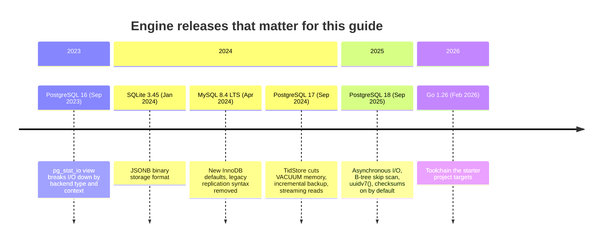

### V.2 Compatibility Matrix

| Engine | Version used here | Released | Community support until | Storage structure | Notes |
| --- | --- | --- | --- | --- | --- |
| PostgreSQL | 18 (CI), 17 also works | Sep 2025 / Sep 2024 | Nov 2030 / Nov 2029 | Heap + nbtree, 8 KiB pages | PostgreSQL 14 support ends November 2026; 13 ended November 2025. |
| MySQL (InnoDB) | 8.4 LTS | Apr 2024 | Apr 2032 (extended) | Clustered B+ tree, 16 KiB pages | 8.0 reached end of life in April 2026. 9.x releases are short-lived innovation releases. |
| SQLite | 3.45 or later | Jan 2024 | The project commits to support through 2050 | B-tree per table/index, 4 KiB pages | One file per database; WAL mode recommended for concurrent readers. |
| RocksDB | current stable | rolling | No LTS; upgrade with the application | LSM tree | Embedded library used by MyRocks, TiKV, Kafka Streams and many others. |
| Go (starter) | 1.26 (go.mod), newer works | Feb 2026 | Until Go 1.28 ships | n/a | Uses method-aware `http.ServeMux` patterns (1.22+) and range-over-int (1.22+). |

### V.3 What's New in PostgreSQL 18

#### Asynchronous I/O

PostgreSQL 18 adds an I/O subsystem that can issue several reads at once instead of one blocking `pread` at a time. Sequential scans, bitmap heap scans and VACUUM use it. `io_method` picks the mechanism: `worker` (default, background I/O worker processes), `io_uring` (Linux, built with liburing) or `sync` (the old behaviour).

```ini
# postgresql.conf before (PostgreSQL 17): synchronous reads, prefetch hints only
effective_io_concurrency = 1
```

```ini
# postgresql.conf after (PostgreSQL 18)
io_method = io_uring          # or worker (default), or sync
io_workers = 3                # used when io_method = worker
effective_io_concurrency = 16 # new default; how many reads may be in flight
```

Stage 2's buffer pool is synchronous; Stage 6 returns to read-ahead and async I/O.

#### B-tree skip scan

Before 18, a multi-column B-tree index was only useful when the query constrained the leading column. PostgreSQL 18 can "skip" through the distinct values of a low-cardinality leading column and probe the second column under each one.

```sql
CREATE INDEX orders_status_created ON orders (status, created_at);

-- PostgreSQL 17: sequential scan, or a second index on created_at alone
-- PostgreSQL 18: can choose an Index Scan on orders_status_created, one probe
--                per distinct status, when status has few distinct values
EXPLAIN SELECT * FROM orders WHERE created_at >= now() - interval '1 day';
```

Section [3.10](#310-clustered-secondary-and-covering-indexes) explains why column order in an index matters.

#### `uuidv7()`

Random UUIDv4 keys land on random leaf pages, which splits pages all over the index and ruins buffer-cache locality (Section [3.4](#34-deletes-fill-factor-and-key-order)). UUIDv7 starts with a millisecond timestamp, so new keys go to the rightmost leaf like a sequence.

```sql
-- before: random insert positions
CREATE TABLE events (id uuid PRIMARY KEY DEFAULT gen_random_uuid(), body jsonb);

-- after (PostgreSQL 18): time-ordered, append-friendly
CREATE TABLE events (id uuid PRIMARY KEY DEFAULT uuidv7(), body jsonb);
```

#### Data checksums on by default

`initdb` now enables page checksums unless you pass `--no-data-checksums`. A checksum mismatch on read raises `ERROR: invalid page in block N of relation ...` instead of returning silently corrupted rows (Section [2.10](#210-torn-pages-full-page-writes-and-checksums)).

```bash
# before: opt in
initdb --data-checksums -D /var/lib/postgresql/17/main
# after: on by default; opt out explicitly
initdb --no-data-checksums -D /var/lib/postgresql/18/main
```

#### `EXPLAIN ANALYZE` reports buffers by default

```sql
-- before: EXPLAIN (ANALYZE, BUFFERS) SELECT ...
-- after:  EXPLAIN ANALYZE SELECT ...   -- now includes "Buffers: shared hit=... read=..."
```

#### Statistics survive `pg_upgrade`

Before 18, a freshly upgraded cluster had no planner statistics until `ANALYZE` finished, and plans were poor for the first minutes or hours. PostgreSQL 18's `pg_upgrade` carries most statistics over.

### V.4 Migration Guide (PostgreSQL 17 → 18)

```bash
# 0. Install the 18 binaries next to 17 (Debian/Ubuntu PGDG packages shown).
sudo apt-get install postgresql-18

# 1. Create the new cluster. Match the old cluster's checksum setting:
#    pg_upgrade refuses to run when one side has checksums and the other does not.
sudo -u postgres /usr/lib/postgresql/17/bin/pg_controldata /var/lib/postgresql/17/main \
  | grep 'Data page checksum version'          # 0 means checksums are off
sudo -u postgres /usr/lib/postgresql/18/bin/initdb --no-data-checksums \
  -D /var/lib/postgresql/18/main               # drop the flag if the old cluster has them

# 2. Dry run. --check changes nothing.
sudo -u postgres /usr/lib/postgresql/18/bin/pg_upgrade \
  --old-bindir=/usr/lib/postgresql/17/bin --new-bindir=/usr/lib/postgresql/18/bin \
  --old-datadir=/var/lib/postgresql/17/main --new-datadir=/var/lib/postgresql/18/main \
  --link --check

# 3. Stop 17 and run the upgrade for real. --link hard-links data files instead
#    of copying them: minutes instead of hours, but the old cluster must not be
#    started again afterwards.
sudo systemctl stop postgresql@17-main
sudo -u postgres /usr/lib/postgresql/18/bin/pg_upgrade \
  --old-bindir=/usr/lib/postgresql/17/bin --new-bindir=/usr/lib/postgresql/18/bin \
  --old-datadir=/var/lib/postgresql/17/main --new-datadir=/var/lib/postgresql/18/main \
  --link

# 4. Start 18 and fill in any statistics pg_upgrade could not carry over
#    (extended statistics, for example).
sudo systemctl start postgresql@18-main
sudo -u postgres /usr/lib/postgresql/18/bin/vacuumdb --all --analyze-in-stages --missing-stats-only
```

For MySQL 8.0 → 8.4, run MySQL Shell's upgrade checker first, then review the changed InnoDB defaults below before the restart:

```bash
mysqlsh --js -e "util.checkForServerUpgrade('root@localhost:3306', {targetVersion: '8.4.0'})"
```

### V.5 Deprecations & Breaking Changes

| Version | Deprecated / removed | Replacement | What breaks and how to fix it |
| --- | --- | --- | --- |
| PostgreSQL 17 | `old_snapshot_threshold` removed | Keep transactions short; monitor `backend_xmin` in `pg_stat_activity` | Server refuses to start if the setting is still in `postgresql.conf`. Delete the line. |
| PostgreSQL 18 | Checksums default to on in `initdb` | `--no-data-checksums` to opt out, `pg_checksums --enable` to convert an old cluster offline | `pg_upgrade` fails with a checksum mismatch error when the old cluster has none. See V.4 step 1. |
| PostgreSQL 18 | MD5 password authentication deprecated | `scram-sha-256` in `pg_hba.conf` and `password_encryption` | Warnings at login and when setting MD5 passwords. Reset passwords after switching `password_encryption`. |
| PostgreSQL 18 | `EXPLAIN ANALYZE` output now includes buffer counts | `EXPLAIN (ANALYZE, BUFFERS OFF)` for the old shape | Tests that compare plan text break. Add `BUFFERS OFF` or compare with a regex. |
| MySQL 8.4 | `CHANGE MASTER TO`, `START SLAVE`, `SHOW SLAVE STATUS`, `SHOW MASTER STATUS` removed | `CHANGE REPLICATION SOURCE TO`, `START REPLICA`, `SHOW REPLICA STATUS`, `SHOW BINARY LOG STATUS` | Replication scripts fail with a syntax error. Rename the statements. |
| MySQL 8.4 | `mysql_native_password` disabled by default (removed in 9.0) | `caching_sha2_password` | Old clients cannot log in. Upgrade the client library or, temporarily, `mysql_native_password=ON`. |
| MySQL 8.4 | New InnoDB defaults: `innodb_adaptive_hash_index=OFF`, `innodb_change_buffering=none`, `innodb_flush_method=O_DIRECT` (Linux), `innodb_io_capacity=10000` | Set the old values explicitly if a benchmark regresses | Workloads that leaned on the adaptive hash index for hot point lookups may get slower; measure before re-enabling. |

---

## 📋 Table of Contents

- [🆕 Database Engine Versions, What's New & Migration](#-database-engine-versions-whats-new--migration)
- [1. Stage 1: Storage Foundations: Disks, Pages & Record Layout](#1-stage-1-storage-foundations-disks-pages--record-layout)
  - [1.1 What a Storage Engine Is](#11-what-a-storage-engine-is)
  - [1.2 The Storage Hierarchy and What It Costs](#12-the-storage-hierarchy-and-what-it-costs)
  - [1.3 Running the Starter Project](#13-running-the-starter-project)
  - [1.4 Files, the Page Cache and fsync](#14-files-the-page-cache-and-fsync)
  - [1.5 Encoding Records as Bytes](#15-encoding-records-as-bytes)
  - [1.6 Slotted Pages](#16-slotted-pages)
  - [1.7 Heap Files, Record IDs and Large Values](#17-heap-files-record-ids-and-large-values)
  - [1.8 Inspecting a Real Heap Page in PostgreSQL](#18-inspecting-a-real-heap-page-in-postgresql)
  - [1.9 Pitfalls](#19-pitfalls)
  - [1.10 Best Practices](#110-best-practices)
  - [1.11 Hands-on Exercise](#111-hands-on-exercise)
- [2. Stage 2: Buffer Pools, Write-Ahead Logging & Crash Recovery](#2-stage-2-buffer-pools-write-ahead-logging--crash-recovery)
  - [2.1 The Buffer Pool](#21-the-buffer-pool)
  - [2.2 Page Replacement: LRU, CLOCK and Scan Resistance](#22-page-replacement-lru-clock-and-scan-resistance)
  - [2.3 Why Not Just mmap the File?](#23-why-not-just-mmap-the-file)
  - [2.4 Steal, Force and the WAL Rule](#24-steal-force-and-the-wal-rule)
  - [2.5 Log Record Format and LSNs](#25-log-record-format-and-lsns)
  - [2.6 Group Commit](#26-group-commit)
  - [2.7 Redo Recovery and the Torn Tail](#27-redo-recovery-and-the-torn-tail)
  - [2.8 ARIES: Analysis, Redo, Undo](#28-aries-analysis-redo-undo)
  - [2.9 Checkpoints and Log Truncation](#29-checkpoints-and-log-truncation)
  - [2.10 Torn Pages, Full-Page Writes and Checksums](#210-torn-pages-full-page-writes-and-checksums)
  - [2.11 Watching the WAL in PostgreSQL](#211-watching-the-wal-in-postgresql)
  - [2.12 Pitfalls](#212-pitfalls)
  - [2.13 Best Practices](#213-best-practices)
  - [2.14 Hands-on Exercise](#214-hands-on-exercise)
- [3. Stage 3: Indexing: B+ Trees, Hash Indexes & LSM Trees](#3-stage-3-indexing-b-trees-hash-indexes--lsm-trees)
  - [3.1 Access Paths and Selectivity](#31-access-paths-and-selectivity)
  - [3.2 B+ Tree Structure and Fanout](#32-b-tree-structure-and-fanout)
  - [3.3 Search, Insert and Node Splits](#33-search-insert-and-node-splits)
  - [3.4 Deletes, Fill Factor and Key Order](#34-deletes-fill-factor-and-key-order)
  - [3.5 Concurrent B+ Trees: Latch Crabbing and B-link Trees](#35-concurrent-b-trees-latch-crabbing-and-b-link-trees)
  - [3.6 Hash Indexes: Static, Extendible and Linear Hashing](#36-hash-indexes-static-extendible-and-linear-hashing)
  - [3.7 LSM Trees: Memtable, Runs and Merge](#37-lsm-trees-memtable-runs-and-merge)
  - [3.8 Compaction Strategies and Amplification](#38-compaction-strategies-and-amplification)
  - [3.9 Bloom Filters](#39-bloom-filters)
  - [3.10 Clustered, Secondary and Covering Indexes](#310-clustered-secondary-and-covering-indexes)
  - [3.11 B+ Tree or LSM Tree?](#311-b-tree-or-lsm-tree)
  - [3.12 Pitfalls](#312-pitfalls)
  - [3.13 Best Practices](#313-best-practices)
  - [3.14 Hands-on Exercise](#314-hands-on-exercise)
- [4. Stage 4: Transactions, Isolation & Concurrency Control](#4-stage-4-transactions-isolation--concurrency-control)
- [5. Stage 5: Query Processing: Parsing, Planning & Execution](#5-stage-5-query-processing-parsing-planning--execution)
- [6. Stage 6: Replication, Consensus & Distributed Transactions](#6-stage-6-replication-consensus--distributed-transactions)
- [M1. Masterclass: ARIES Recovery End to End](#m1-masterclass-aries-recovery-end-to-end)
- [M2. Masterclass: LSM Compaction and RocksDB Tuning](#m2-masterclass-lsm-compaction-and-rocksdb-tuning)
- [M3. Masterclass: PostgreSQL MVCC, VACUUM and Freezing](#m3-masterclass-postgresql-mvcc-vacuum-and-freezing)
- [M4. Masterclass: Raft from Scratch](#m4-masterclass-raft-from-scratch)
- [M5. Masterclass: Distributed ACID: Spanner, Percolator and Calvin](#m5-masterclass-distributed-acid-spanner-percolator-and-calvin)
- [M6. Masterclass: Flagship Blueprint: A Replicated Key-Value Store](#m6-masterclass-flagship-blueprint-a-replicated-key-value-store)
- [7. Stage 7: Staff Database Internals Engineer Interview Handbook & Cheatsheet](#7-stage-7-staff-database-internals-engineer-interview-handbook--cheatsheet)
- [🧪 Example Projects](#-example-projects)
- [📝 Cheat Sheets](#-cheat-sheets)
- [📚 Resources](#-resources)
- [🤝 Contributing](#-contributing)
- [📄 License](#-license)
- [🙏 Acknowledgments](#-acknowledgments)
- [🌐 Connect with me](#-connect-with-me)
- [☕ Support](#-support)

---

## 1. Stage 1: Storage Foundations: Disks, Pages & Record Layout

This stage covers the layer every other part of a database rests on: how bytes reach a disk, how they survive a crash, and how variable-length rows are packed into fixed-size pages. You need basic Go (structs, slices, `go test`) and enough SQL to run `SELECT`. By the end you can explain a PostgreSQL heap page byte by byte and you have a tested slotted-page implementation of your own.

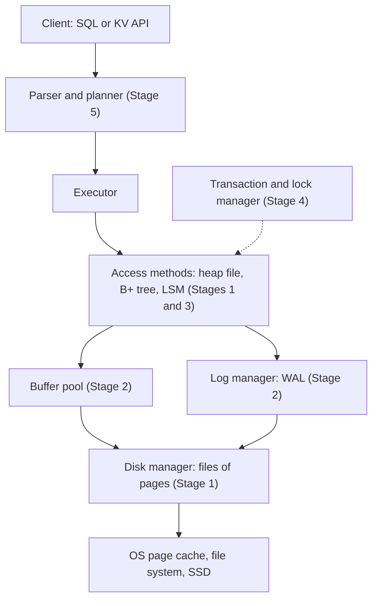

### 1.1 What a Storage Engine Is

A database server is a stack of layers. The top half (protocol, parser, planner, executor) decides *what* data a query needs. The bottom half, the **storage engine**, decides *how* that data is laid out on disk, how it is found again, and how it survives crashes. The two halves meet at an interface such as "scan this table", "look up this key in this index" or "insert this row".

Some systems make the boundary explicit. MySQL lets you choose an engine per table (InnoDB, MyRocks, MEMORY). PostgreSQL has had a table access method API since version 12, which lets extensions replace the heap. MongoDB runs on WiredTiger. Many distributed SQL systems put a SQL layer on top of an embedded key-value engine: CockroachDB on Pebble, TiDB on TiKV (which uses RocksDB), YugabyteDB on a modified RocksDB.

| Engine | Used by | On-disk structure | Page / block size | Written in |
| --- | --- | --- | --- | --- |
| PostgreSQL heap + nbtree | PostgreSQL | Unordered heap pages plus separate B+ tree indexes | 8 KiB | C |
| InnoDB | MySQL, MariaDB | Clustered B+ tree on the primary key; secondary indexes store the primary key | 16 KiB | C++ |
| SQLite | Embedded everywhere | One B+ tree per table (keyed by rowid) and per index, in one file | 4 KiB default | C |
| WiredTiger | MongoDB | B-tree with in-memory page images and on-disk reconciliation | variable | C |
| RocksDB | MyRocks, TiKV, Kafka Streams state stores | LSM tree | 4 KiB data blocks in SSTables | C++ |
| Pebble | CockroachDB | LSM tree, RocksDB-compatible format | 4 KiB blocks | Go |
| bbolt | etcd, Consul | Copy-on-write B+ tree in one memory-mapped file | OS page size | Go |

Every engine in that table answers the same five questions, which are the spine of Stages 1-3:

1. **Layout**: how is a row turned into bytes, and where do those bytes go? (1.5-1.7)
2. **Caching**: which pages stay in memory, and when are changed pages written back? (2.1-2.3)
3. **Durability**: what is on disk at the instant of a crash, and how is a consistent state rebuilt? (2.4-2.10)
4. **Access**: how is one row found among a billion without reading them all? (3.1-3.10)
5. **Concurrency**: how do many threads read and write the same pages safely? (3.5 here, Stage 4 in full)

### 1.2 The Storage Hierarchy and What It Costs

Storage engine design is mostly a response to the gaps between these numbers. They are order-of-magnitude figures for current hardware; measure your own with `fio` before you tune anything.

| Operation | Typical latency | Relative to a DRAM access |
| --- | --- | --- |
| L1 cache hit | ~1 ns | 0.01x |
| DRAM access | ~100 ns | 1x |
| Copy 4 KiB in memory | ~0.5 µs | 5x |
| NVMe SSD random 4 KiB read | 20-100 µs | 200-1,000x |
| `fsync` on an NVMe SSD with power-loss protection | 20-100 µs | 200-1,000x |
| `fsync` on a consumer SSD without power-loss protection | 1-10 ms | 10,000-100,000x |
| Round trip inside one data centre | ~0.5 ms | 5,000x |
| HDD seek + rotation | 5-10 ms | 50,000-100,000x |
| Round trip between continents | 70-150 ms | ~1,000,000x |

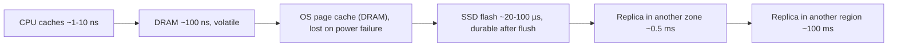

Three consequences shape everything that follows:

- **Durability has a price per commit.** If every commit waits for an `fsync`, a single writer on a consumer SSD tops out at a few hundred commits per second. Group commit (2.6) and fast, power-loss-protected drives are how real systems get past that.
- **The unit of I/O is a block, not a byte.** Reading one byte costs a full 4 KiB read, so engines pack related data into pages and try to make every page read useful.
- **Flash cannot overwrite in place.** An SSD writes in flash pages (4-16 KiB) but erases in much larger erase blocks (several MiB). The flash translation layer (FTL) writes new data to fresh pages and garbage-collects old blocks in the background. Random small overwrites therefore cost more physical writes than they appear to: this is device-level **write amplification**, and it is one reason log-structured designs (3.7) are attractive on flash.

Random reads, on the other hand, are cheap on SSDs when you issue many at once: an NVMe drive serves hundreds of thousands of random reads per second at high queue depth. That is why PostgreSQL 18 added asynchronous I/O and why B+ trees, which do random reads, remain the default on SSDs.

### 1.3 Running the Starter Project

The repository root is a Go module containing a small but complete storage engine. Each package matches a section of this guide and has its own tests.

```text
.
├── cmd/server/main.go        HTTP server: reads PORT and DATA_DIR, recovers, serves
├── internal/
│   ├── page/                 slotted page                      (1.6)
│   ├── record/               varint key/value encoding         (1.5)
│   ├── fsutil/               atomic file replace, dir fsync    (1.4)
│   ├── buffer/               buffer pool with CLOCK            (2.1, 2.2)
│   ├── wal/                  CRC32C log, group commit, replay  (2.5-2.7)
│   ├── kv/                   WAL + B+ tree = durable KV store  (2.7)
│   ├── btree/                in-memory B+ tree                 (3.2-3.4)
│   ├── bloom/                Bloom filter                      (3.9)
│   ├── lsm/                  memtable, sorted runs, compaction (3.7, 3.8)
│   └── server/               HTTP handlers
└── sql/                      PostgreSQL walkthroughs, one per stage
```

Run the tests (Go 1.26 or newer; `-race` needs a C toolchain on some platforms):

```bash
go test -race ./...
go test -v -run TestGroupCommit ./internal/wal   # prints how many fsyncs 400 commits needed
```

Start the server and use it:

```bash
DATA_DIR=./data go run ./cmd/server
# in a second terminal
curl -X PUT --data 'Ada Lovelace' localhost:8080/kv/user:1
curl -X PUT --data 'Edgar Codd'   localhost:8080/kv/user:2
curl localhost:8080/kv/user:1                       # Ada Lovelace
curl 'localhost:8080/scan?start=user:&end=user;'    # ordered range scan, JSON
curl localhost:8080/stats                           # {"keys":2,"wal_bytes":...}
```

Stop the server with `Ctrl+C`, or kill it hard with `kill -9`, and start it again: the log replays and both keys come back. The start-up line shows how long recovery took:

```text
INFO recovered dir=./data keys=2 wal_bytes=56 took=212µs
```

Or run the container that CI builds:

```bash
docker build -t learn-database-internals .
docker run --rm -p 8080:8080 -v kvdata:/tmp/kvdb learn-database-internals
```

`cmd/server/main.go` is short; the lines that matter for a storage engine are these:

```go
store, err := kv.Open(dir, kv.Options{NoSync: os.Getenv("NO_SYNC") == "1"})
if err != nil {
	return err
}
defer store.Close()
slog.Info("recovered", "dir", dir, "keys", store.Len(), "wal_bytes", store.LogSize(), "took", time.Since(start))

srv := &http.Server{
	Addr:              net.JoinHostPort("0.0.0.0", port),
	Handler:           server.New(store),
	ReadHeaderTimeout: 5 * time.Second,
}
ctx, stop := signal.NotifyContext(context.Background(), os.Interrupt, syscall.SIGTERM)
```

| Line / API | Role | What happens at runtime |
| :--- | :--- | :--- |
| `kv.Open(dir, ...)` | Recovery | Opens `wal.log`, replays every intact record into a new B+ tree, truncates a torn tail. The server does not accept requests until this returns. |
| `NO_SYNC=1` | Durability knob | Skips `fsync` per write. A process crash loses nothing (the bytes are in the OS page cache); a power failure can lose the last writes. |
| `defer store.Close()` | Clean shutdown | Syncs and closes the log, so a graceful stop never needs to replay a torn record. |
| `0.0.0.0` | Bind address | Listens on every interface so the container port mapping works. `localhost` would only accept connections from inside the container. |
| `ReadHeaderTimeout` | Hygiene | Stops slow clients from holding connections open forever. |
| `signal.NotifyContext` | Graceful stop | `SIGTERM` (sent by Docker and Kubernetes) stops new requests, lets in-flight ones finish, then runs the deferred `Close`. |

### 1.4 Files, the Page Cache and fsync

A storage engine talks to the disk through a handful of system calls. Knowing exactly what each one promises is the difference between a database and a data-loss bug.

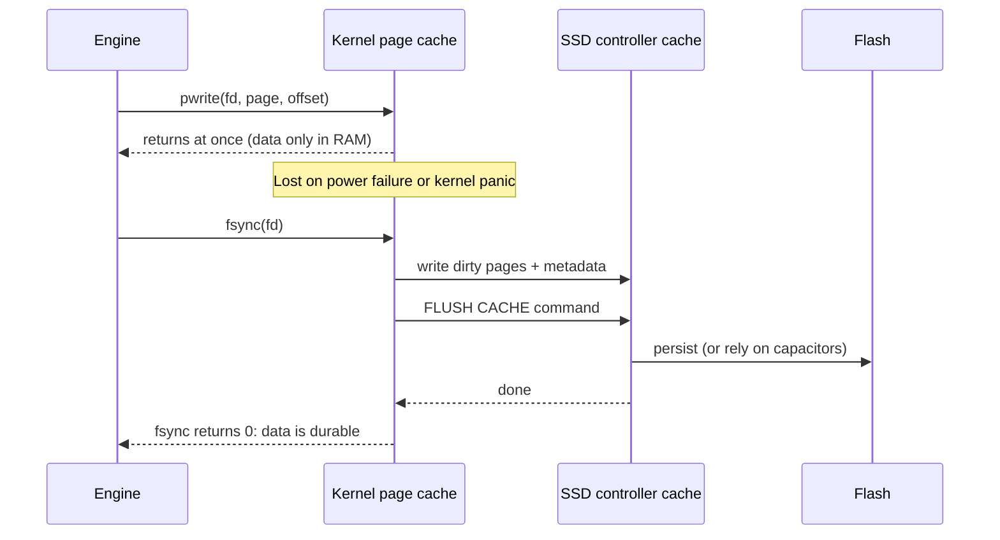

| Call | What it guarantees | Used for |
| --- | --- | --- |
| `pwrite(fd, buf, off)` / Go `f.WriteAt` | The bytes are in the kernel page cache. Nothing about durability. | Writing pages and log records |
| `pread(fd, buf, off)` / Go `f.ReadAt` | Reads from the page cache, or from disk on a miss | Reading pages |
| `fsync(fd)` / Go `f.Sync()` | File data and metadata (size, timestamps) are on stable storage | Commit, checkpoint |
| `fdatasync(fd)` | File data and the metadata needed to read it (size), but not timestamps | WAL segments that are preallocated, so the size never changes |
| `fsync` on the directory | The directory entry (a file creation, rename or delete) is durable | After creating a WAL segment or renaming a file |
| `O_DIRECT` | Reads and writes bypass the page cache; buffers must be aligned | Engines with their own cache: InnoDB (`O_DIRECT` is the Linux default in MySQL 8.4), RocksDB with `use_direct_reads` |
| `O_DSYNC` | Every write behaves like write + `fdatasync` | Some WAL implementations, e.g. PostgreSQL `wal_sync_method = open_datasync` |

Three facts catch people out:

1. **`write` returning is not durability.** A database that acknowledges a commit after `write` but before `fsync` loses committed data on power failure. A *process* crash is fine, because the kernel still holds the bytes; a *machine* crash is not.
2. **A failed `fsync` cannot be retried.** In 2018 PostgreSQL developers found that on Linux, after a write-back error, the kernel could mark the dirty pages clean and report the error only once. A second `fsync` then succeeded even though the data was gone. PostgreSQL now treats a failed `fsync` as a reason to crash and recover from the WAL (`data_sync_retry = off`). The starter's `wal` package does the same thing: the log becomes read-only after a failed sync.
3. **New files need a directory fsync.** Creating a file and calling `fsync` on it makes its *contents* durable but not its *name*. After a crash the file can be missing. The fix is to `fsync` the directory too.

The safest way to replace a small file (a manifest, a checkpoint pointer, RocksDB's `CURRENT`) is write-to-temp, fsync, rename, fsync-directory. This is `internal/fsutil/atomic.go`:

```go
func WriteFileAtomic(path string, data []byte, perm os.FileMode) error {
	dir := filepath.Dir(path)
	tmp, err := os.CreateTemp(dir, "."+filepath.Base(path)+".tmp-*")
	if err != nil {
		return err
	}
	tmpName := tmp.Name()
	defer os.Remove(tmpName) // no-op after a successful rename

	if _, err := tmp.Write(data); err != nil {
		tmp.Close()
		return err
	}
	if err := tmp.Chmod(perm); err != nil {
		tmp.Close()
		return err
	}
	if err := tmp.Sync(); err != nil {
		tmp.Close()
		return err
	}
	if err := tmp.Close(); err != nil {
		return err
	}
	if err := os.Rename(tmpName, path); err != nil {
		return err
	}
	return SyncDir(dir)
}
```

| Line / API | Role | What happens at runtime |
| :--- | :--- | :--- |
| `os.CreateTemp(dir, ...)` | Same directory as the target | `rename` is only atomic within one file system; a temp file in `/tmp` might be on a different one. |
| `tmp.Sync()` | Data durable before the name changes | Without it, a crash after the rename can leave the new name pointing at an empty or partial file. |
| `os.Rename` | Atomic switch | Readers see the old file or the new file, never a mix. On POSIX this replaces the target in one step. |
| `SyncDir(dir)` | Rename durable | Persists the directory entry change; without it the old file can reappear after a crash. |
| `defer os.Remove(tmpName)` | Cleanup | Removes the temp file on any error path. After a successful rename the name no longer exists and the call does nothing. |

**Page size.** Engines read and write fixed-size pages: 4 KiB (SQLite, RocksDB data blocks), 8 KiB (PostgreSQL, fixed at compile time), 16 KiB (InnoDB default, fixed when the instance is initialised). Bigger pages mean higher B+ tree fanout and fewer I/Os per lookup, but more bytes read per random access and more data at risk from a torn write (2.10). Most file systems and SSDs only promise that an aligned 4 KiB write (sometimes only 512 bytes) is atomic.

### 1.5 Encoding Records as Bytes

Before a row can go into a page it has to become a byte string. The choices are about space, CPU and how much the format must know about the schema.

| Technique | How it works | Who uses it |
| --- | --- | --- |
| Fixed-width fields | Each column at a known offset; `int8` always 8 bytes | Fixed-width columns in PostgreSQL and InnoDB rows |
| Length prefix | Write the length, then the bytes | Every variable-length type |
| Varint | 7 bits of value per byte, high bit means "more follows" | SQLite record format, LevelDB/RocksDB, Protocol Buffers |
| Null bitmap | One bit per column; null columns take no space | PostgreSQL `t_bits`, InnoDB compact row format |
| Offset array | Header lists where each variable-length field starts, so field *n* is found without parsing fields 1..*n*-1 | InnoDB compact format, many columnar formats |
| Alignment padding | Fields start at multiples of their alignment (8 for `int8`) so the CPU can load them directly | PostgreSQL, C structs |

The starter project's log records use the simplest useful format, a pair of length-prefixed strings with varint lengths (`internal/record/record.go`):

```go
// Append encodes key and value onto dst and returns the extended slice.
func Append(dst, key, value []byte) []byte {
	dst = binary.AppendUvarint(dst, uint64(len(key)))
	dst = append(dst, key...)
	dst = binary.AppendUvarint(dst, uint64(len(value)))
	return append(dst, value...)
}

func field(b []byte) ([]byte, int, error) {
	l, n := binary.Uvarint(b)
	if n <= 0 || uint64(len(b)-n) < l {
		return nil, 0, ErrTruncated
	}
	end := n + int(l)
	return b[n:end:end], end, nil
}
```

| Line / API | Role | What happens at runtime |
| :--- | :--- | :--- |
| `binary.AppendUvarint` | Length prefix | Lengths below 128 take 1 byte, below 16,384 take 2. A fixed `uint32` prefix would waste 3 bytes on every short key. |
| `append(dst, ...)` | Zero-copy friendly | The caller passes a buffer to reuse, so encoding a batch allocates once. |
| `binary.Uvarint(b)` returns `n <= 0` | Truncation and overflow | `n == 0` means the buffer ended mid-varint; `n < 0` means the varint is longer than 64 bits. Both are corrupt input. |
| `uint64(len(b)-n) < l` | Bounds check | Refuses to slice past the end when a corrupt length claims more bytes than exist. This is the check that keeps a fuzzer from crashing the decoder. |
| `b[n:end:end]` | Full slice expression | Caps the capacity so a caller who appends to the returned key cannot overwrite the value that follows it in the buffer. |

**Alignment costs real space.** PostgreSQL aligns each column to its type's alignment, so column order changes row size. You can measure it:

```sql
SELECT pg_column_size(ROW(true, 1::bigint, true, 1::bigint)) AS interleaved,  -- 56
       pg_column_size(ROW(1::bigint, 1::bigint, true, true)) AS grouped;      -- 42
```

The 24-byte tuple header is common to both. In the interleaved row each `boolean` is followed by 7 bytes of padding so that the next `bigint` starts on an 8-byte boundary. On a billion-row table that is 14 GB of padding. Put fixed-width 8-byte columns first, then 4-byte, then 2-byte, then 1-byte and variable-length columns.

### 1.6 Slotted Pages

A page has to hold records of different sizes, let them be deleted and resized, and still give each record an address that does not change when its neighbours move. The **slotted page** layout does this, and nearly every row store uses a variant of it.

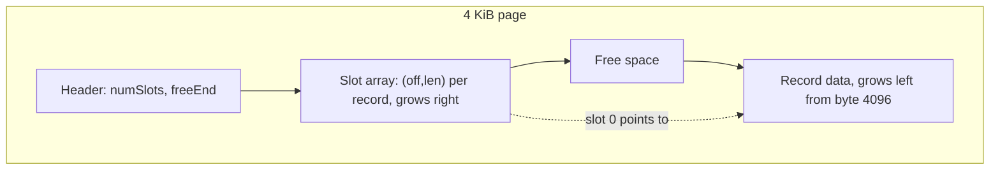

- The **header** stores the number of slots and `freeEnd`, the offset where record data begins.
- The **slot array** grows from the front. Slot *i* holds the offset and length of record *i*.
- **Record data** grows from the back. The page is full when the two meet.
- A record's address is `(page number, slot number)`. Moving the record inside the page only changes the offset in its slot; the slot number, and therefore every index entry pointing at the record, stays valid.

The starter's `Insert` (`internal/page/page.go`):

```go
func (p *Page) Insert(rec []byte) (int, error) {
	if len(rec) > MaxRecord {
		return -1, ErrTooLarge
	}
	slot := p.freeSlot()
	need := len(rec)
	if slot < 0 {
		need += slotSize
	}
	if p.FreeSpace() < need {
		p.Compact()
		if p.FreeSpace() < need {
			return -1, ErrNoSpace
		}
	}
	if slot < 0 {
		slot = p.NumSlots()
		p.setNumSlots(slot + 1)
	}
	start := p.freeEnd() - len(rec)
	copy(p.buf[start:], rec)
	p.setFreeEnd(start)
	p.setSlot(slot, start, len(rec))
	return slot, nil
}
```

| Line / API | Role | What happens at runtime |
| :--- | :--- | :--- |
| `MaxRecord = Size - headerSize - slotSize` | Hard limit | The largest record an empty page can take: 4088 bytes. Anything larger needs overflow storage (1.7). |
| `p.freeSlot()` | Slot reuse | Scans for a slot whose offset is 0 (deleted). Reusing it avoids growing the slot array, so only the record bytes are needed. |
| `need += slotSize` | Space accounting | A brand-new slot costs 4 more bytes from the same free region. |
| `p.Compact()` | Defragmentation | Deletes leave holes between records. Compaction slides live records to the end of the page so the holes join the free region. Slot numbers do not change. |
| `start := p.freeEnd() - len(rec)` | Placement | The record goes just below the current data start, so record data stays contiguous. |
| `p.setSlot(slot, start, len(rec))` | Publishing | The slot is written last. A reader that sees the slot sees a complete record. (With concurrent access you would still need a page latch, Stage 3.5.) |

`Compact` is the reason the indirection is worth having:

```go
func (p *Page) Compact() {
	type live struct {
		slot int
		data []byte
	}
	var recs []live
	for s := 0; s < p.NumSlots(); s++ {
		if rec, err := p.Get(s); err == nil {
			recs = append(recs, live{s, rec})
		}
	}
	end := Size
	for _, r := range recs {
		end -= len(r.data)
		copy(p.buf[end:], r.data)
		p.setSlot(r.slot, end, len(r.data))
	}
	p.setFreeEnd(end)
}
```

The test `TestFillThenCompact` fills a page with 39 records of 100 bytes (39 × 104 = 4056 of the 4092 usable bytes), deletes every second one, then inserts a 1000-byte record. No contiguous hole is that big, so `Insert` compacts first, and the test checks that the surviving records kept their slot numbers.

**How real engines differ.** PostgreSQL's line pointers are 4 bytes and carry a 2-bit state (`LP_NORMAL`, `LP_REDIRECT`, `LP_DEAD`, `LP_UNUSED`), and compaction happens during page pruning. InnoDB chains records in key order through a "next record" pointer and keeps a sparse *page directory* of every 4th-8th record for binary search inside the page. SQLite cell pointers are 2-byte offsets sorted by key, because each SQLite page is a B-tree node.

### 1.7 Heap Files, Record IDs and Large Values

A **heap file** is a table stored as an unordered collection of pages. Inserts go wherever there is room, which makes them cheap, and finding a row by value needs either a full scan or an index (Stage 3).

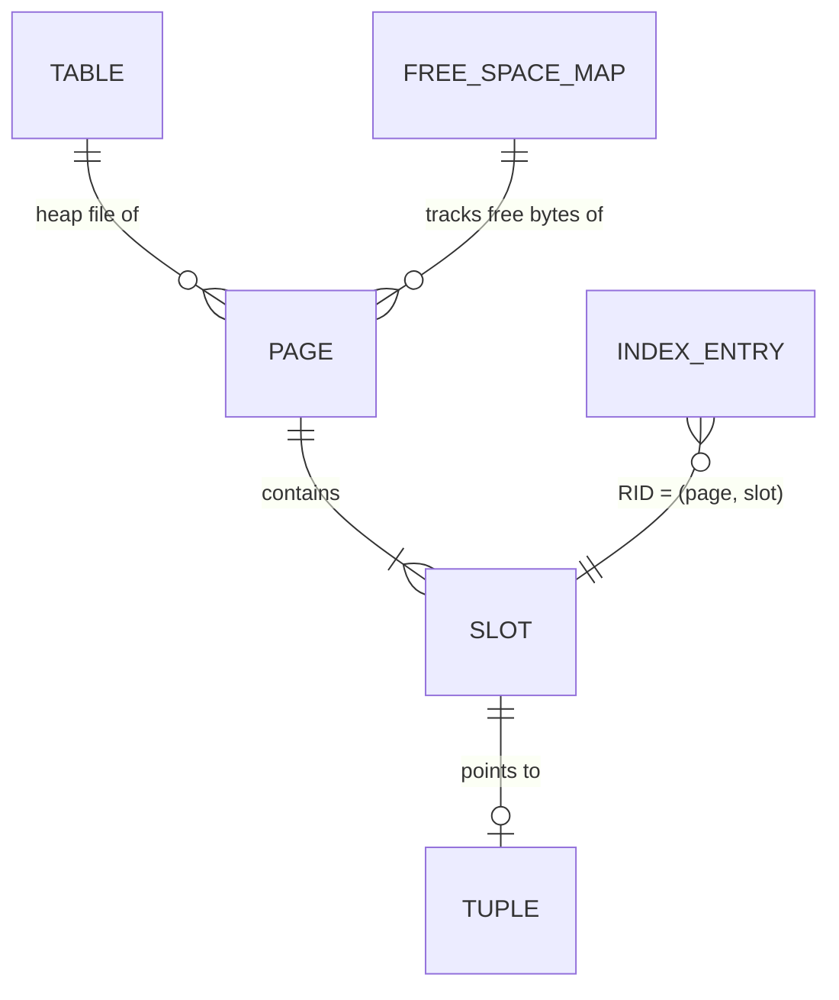

To insert, the engine needs a page with enough room. Scanning every page would be absurd, so engines keep a **free space map**: PostgreSQL stores one byte per heap page in a separate `_fsm` fork (a coarse measure of free space, kept as a small tree so a page with N free bytes can be found quickly). InnoDB tracks free space per extent and segment.

A **record ID** (RID, PostgreSQL calls it `ctid`, the "tuple ID") is `(page number, slot number)`. Indexes store RIDs, so a lookup is "search the index, get the RID, read that one page".

The alternative is a **clustered** layout, in which the table *is* a B+ tree ordered by primary key and rows live in its leaves. The two designs make different trade-offs:

| | Heap + secondary indexes (PostgreSQL) | Clustered index (InnoDB, SQLite rowid tables) |
| --- | --- | --- |
| Insert | Any page with room; cheap | Must go to the correct leaf in key order; random keys cause page splits |
| Lookup by primary key | Index search, then one heap page read | One tree search; the row is in the leaf |
| Secondary index entries hold | RID (6 bytes in PostgreSQL) | The primary key, which can be long |
| Secondary index lookup | Index search, then heap page read | Secondary search, then a second search of the clustered tree |
| Row moves (update grows the row) | RID changes; every index must be updated, unless the update is HOT (Stage 4) | Primary key does not change, so secondary indexes stay valid |
| Range scan by primary key | Rows scattered across the heap unless `CLUSTER` was run recently | Rows are physically in key order |

**Values larger than a page.** A 50 KB JSON document does not fit in an 8 KiB page. PostgreSQL's TOAST compresses values above about 2 KB and, if they are still too large, moves them into a separate TOAST table split into chunks; the main tuple keeps an 18-byte pointer. InnoDB stores large `BLOB`/`TEXT`/`JSON` columns on overflow pages and keeps a 20-byte pointer in the row (DYNAMIC row format). SQLite chains overflow pages. In all three, `SELECT *` on a table with large columns pays for reading the overflow pages; selecting only the columns you need avoids it.

### 1.8 Inspecting a Real Heap Page in PostgreSQL

[`sql/01-heap-pages.sql`](sql/01-heap-pages.sql) creates a 20-row table and reads page 0 with the `pageinspect` extension. Run it against any PostgreSQL 17 or 18 server you are allowed to create extensions on:

```bash
docker run -d --name pg -e POSTGRES_PASSWORD=pw -p 5432:5432 postgres:18
PGHOST=localhost PGUSER=postgres PGPASSWORD=pw bash sql/run-all.sh
```

The page header:

```sql
SELECT lsn, lower, upper, upper - lower AS free_bytes, special, pagesize
FROM page_header(get_raw_page('s1_accounts', 0));
```

```text
    lsn    | lower | upper | free_bytes | special | pagesize
-----------+-------+-------+------------+---------+----------
 0/157C8F8 |   104 |  7232 |       7128 |    8192 |     8192
```

`lower` is the end of the line-pointer array: a 24-byte page header plus 20 line pointers × 4 bytes = 104. `upper` is where tuple data begins. The `lsn` is the WAL position of the last change to this page, which Stage 2 relies on. This is the same layout as the starter's `page` package, with PostgreSQL's names.

The line pointers and tuple headers:

```sql
SELECT lp, lp_off, lp_len, t_xmin, t_xmax, t_ctid
FROM heap_page_items(get_raw_page('s1_accounts', 0))
ORDER BY lp LIMIT 5;
```

```text
 lp | lp_off | lp_len | t_xmin | t_xmax | t_ctid
----+--------+--------+--------+--------+--------
  1 |   8144 |     41 |    745 |      0 | (0,1)
  2 |   8096 |     41 |    745 |      0 | (0,2)
  3 |   8048 |     41 |    745 |      0 | (0,3)
```

Each tuple is 41 bytes but they are 48 bytes apart: PostgreSQL pads each tuple to an 8-byte boundary. `t_xmin` is the ID of the transaction that inserted the row.

Now update one row and look again:

```sql
UPDATE s1_accounts SET balance = balance + 1 WHERE id = 1;
SELECT lp, t_xmin, t_xmax, t_ctid
FROM heap_page_items(get_raw_page('s1_accounts', 0)) WHERE lp IN (1, 21);
```

```text
 lp | t_xmin | t_xmax | t_ctid
----+--------+--------+--------
  1 |    745 |    746 | (0,21)
 21 |    746 |      0 | (0,21)
```

PostgreSQL never overwrites a row in place. The UPDATE wrote a new version in slot 21 and stamped the old one with `t_xmax = 746` and a forward pointer `t_ctid = (0,21)`. Both versions stay on the page until VACUUM removes the old one. This is MVCC, the subject of Stage 4, and it is visible here as plain bytes in a slotted page.

| Field | Meaning | Starter-project equivalent |
| --- | --- | --- |
| `lower` / `upper` | End of slot array / start of data | `headerSize + numSlots*slotSize` / `freeEnd` |
| `lp`, `lp_off`, `lp_len` | Slot number, offset, length | slot index, `(off, len)` |
| `ctid` | `(block, line pointer)` record ID | `(PageID, slot)` |
| `lsn` | Last WAL record that touched the page | Not stored yet (Stage 2 exercise) |
| `t_xmin`, `t_xmax` | Creating and deleting transaction IDs | None: the starter has no transactions until Stage 4 |

### 1.9 Pitfalls

| Pitfall | Symptom | Fix |
| --- | --- | --- |
| Acknowledging a write after `write()` but before `fsync()` | Rows that clients were told were committed are missing after a power cut or VM host failure; tests that `kill -9` the process never catch it | `fsync` (or `fdatasync`) before acknowledging; test durability by cutting power to a VM, not by killing the process |
| Retrying a failed `fsync` | Second `fsync` returns 0, data written before the error is silently gone | Treat `fsync` failure as fatal for that file: crash and recover from the log |
| Creating a file without fsyncing its directory | After a crash, `open: no such file or directory` for a WAL segment or SSTable that was "written" | `fsync` the parent directory after create, rename and unlink (`fsutil.SyncDir`) |
| Temp file in a different file system before `rename` | `rename ... invalid cross-device link` (`EXDEV`) | Create the temp file in the destination directory |
| Trusting a length field read from disk | `panic: runtime error: slice bounds out of range`, or a multi-GB allocation, on a corrupt file | Bounds-check every length against the remaining buffer and a maximum (`record.field`, `wal.MaxRecord`) |
| Returning a slice into the page buffer | Values change "by themselves" after a later insert or compaction reuses the bytes | Copy out (`page.Get` returns a copy) or document that the slice is valid only while the page is pinned |
| Column order that maximises padding | Table 20-30% larger than the data suggests | Order columns by alignment, widest fixed-width first; check with `pg_column_size` |
| Assuming 8 KiB writes are atomic | After a crash, pages with the first half new and second half old: `invalid page in block` with checksums on, silent corruption without | Full-page writes or a doublewrite buffer (2.10) |

### 1.10 Best Practices

- **Make every on-disk format self-describing enough to validate**: a length that can be bounds-checked and a checksum let you detect corruption instead of misreading it.
- **Treat the page as the unit of everything**: I/O, caching, locking and logging all work on pages, so design record layout around page boundaries.
- **Keep record IDs stable**: an extra level of indirection (slots) is cheaper than updating every index when a record moves within a page.
- **Separate "written" from "durable" in your API**: the starter's `wal.Append` and `wal.SyncTo` make the difference visible to callers.
- **Measure fsync latency on the real hardware**: `pg_test_fsync` (ships with PostgreSQL) or `fio --fsync=1` tells you the commit-rate ceiling before you promise one.
- **Prefer power-loss-protected SSDs for databases**: they can acknowledge a flush from capacitor-backed cache, which cuts commit latency by one to two orders of magnitude.
- **Copy at API boundaries, not in hot loops**: copy when handing data to callers who keep it; inside the engine, pass slices that are valid while the page is pinned.

### 1.11 Hands-on Exercise

**Task.** Add `Update(slot int, rec []byte) error` to `internal/page`. If the new record fits in the old record's space, overwrite it in place. Otherwise, free the old bytes and place the record elsewhere on the page, compacting if needed, **without changing the slot number**. Return `ErrNoSpace` if the page cannot hold it even after compaction, and leave the old record intact in that case.

**Tests to write** in `internal/page/page_test.go`:

1. Shrinking update: `Update(0, "ab")` on a record `"abcdef"` returns nil and `Get(0)` returns `"ab"`.
2. Growing update on a nearly full page triggers compaction and succeeds.
3. Update that cannot fit returns `ErrNoSpace` and `Get` still returns the old value.

**Expected output.**

```text
$ go test -run Update -v ./internal/page
=== RUN   TestUpdateShrink
--- PASS: TestUpdateShrink
=== RUN   TestUpdateGrowCompacts
--- PASS: TestUpdateGrowCompacts
=== RUN   TestUpdateTooLargeKeepsOld
--- PASS: TestUpdateTooLargeKeepsOld
PASS
```

**Where the pieces are.** `Insert` and `Compact` in `internal/page/page.go` contain every building block you need; `TestFillThenCompact` shows how to set up a fragmented page. Hint: for the growing case, mark the slot free, check `FreeSpace()` plus compaction, and restore the old slot if it still does not fit.

[Back to top ⤴️](#-table-of-contents)

---

## 2. Stage 2: Buffer Pools, Write-Ahead Logging & Crash Recovery

Stage 1 put records into pages. This stage keeps hot pages in memory, decides when changed pages go back to disk, and makes sure that a crash at any instant leaves enough on disk to rebuild a consistent database. It assumes Stage 1. By the end you can explain why every serious engine writes a log before it writes data, read the starter's WAL and recovery code line by line, and measure group commit on your own machine.

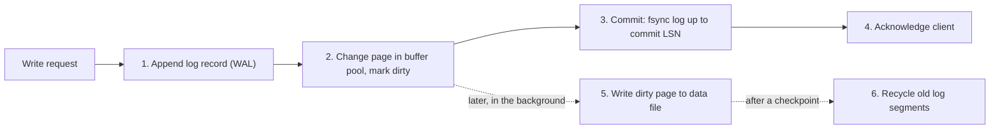

### 2.1 The Buffer Pool

The buffer pool is the engine's own page cache: a fixed array of page-sized **frames** in memory plus a **page table** that maps a page ID to the frame holding it. Every access method reads and writes pages through it and never touches the data files directly.

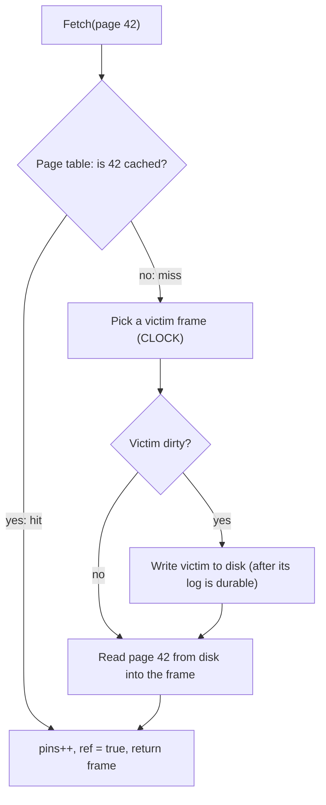

Each frame carries a little metadata:

| Field | Meaning | Why it matters |
| --- | --- | --- |
| `id` | Which disk page the frame holds | Needed to write it back to the right place |
| `pins` | How many callers are using the frame right now | A pinned frame must not be evicted: someone holds a pointer into it |
| `dirty` | The frame differs from the disk copy | Eviction must write it back first |
| `ref` | Recently used (the CLOCK reference bit) | Gives a recently used page a second chance before eviction |
| page LSN (in the page itself) | Last log record that changed the page | Enforces the WAL rule on write-back (2.4) |

`Fetch` in `internal/buffer/pool.go`:

```go
func (p *Pool) Fetch(id PageID) ([]byte, error) {
	p.mu.Lock()
	defer p.mu.Unlock()
	if i, ok := p.table[id]; ok {
		f := &p.frames[i]
		f.pins++
		f.ref = true
		p.Hits++
		return f.data, nil
	}
	p.Misses++
	i := p.victim()
	if i < 0 {
		return nil, ErrNoFreeFrame
	}
	f := &p.frames[i]
	if f.valid {
		if f.dirty {
			if err := p.disk.WritePage(f.id, f.data); err != nil {
				return nil, fmt.Errorf("buffer: write back page %d: %w", f.id, err)
			}
			p.Writes++
		}
		delete(p.table, f.id)
		p.Evictions++
	}
	if err := p.disk.ReadPage(id, f.data); err != nil {
		f.valid = false
		return nil, err
	}
	*f = frame{id: id, data: f.data, pins: 1, ref: true, valid: true}
	p.table[id] = i
	return f.data, nil
}
```

| Line / API | Role | What happens at runtime |
| :--- | :--- | :--- |
| `p.mu.Lock()` | Protects metadata | One mutex guards the page table and frame headers. Real engines partition this (PostgreSQL has 128 buffer-mapping partitions) because a single lock becomes the bottleneck. |
| `f.pins++` on a hit | Pinning | The caller now holds a reference. It must call `Unpin` exactly once, or the frame can never be evicted (a "pin leak"). |
| `p.victim()` | Replacement | Chooses a frame with `pins == 0` using CLOCK (2.2). Returns -1 when every frame is pinned. |
| `ErrNoFreeFrame` | Back-pressure | PostgreSQL reports this situation as `ERROR: no unpinned buffers available`. It almost always means a pin leak or a pool far too small for the concurrency. |
| `WritePage` before reuse | Write-back | A dirty victim is written before its frame is reused. Doing this I/O while holding the pool mutex is simple but slow; real engines release the lock or let a background writer keep clean frames available. |
| `*f = frame{...}` | Reset | The frame is re-labelled for the new page with `pins = 1`, so it cannot be stolen before the caller sees it. |

**Pins are not latches.** A pin says "do not evict this frame". It does not stop two threads from changing the bytes at the same time. That needs a per-page reader-writer **latch**, held for microseconds while a page is read or modified. Locks, held for the length of a transaction, protect logical rows and are a Stage 4 topic. The three are often confused:

| | Pin | Latch | Lock |
| --- | --- | --- | --- |
| Protects | Frame from eviction | Page bytes from concurrent modification | Logical data (rows, keys, tables) from concurrent transactions |
| Held for | As long as a pointer into the frame is in use | Microseconds | Until commit or abort |
| Deadlock handling | None needed | Avoided by acquisition order (3.5) | Detected and broken (Stage 4) |
| PostgreSQL name | buffer pin | buffer content lock (LWLock) | heavyweight lock (`pg_locks`) |

### 2.2 Page Replacement: LRU, CLOCK and Scan Resistance

When the pool is full, which page goes? The ideal answer, "the one used furthest in the future", is unknowable, so engines approximate it.

| Policy | How it chooses | Strength | Weakness |
| --- | --- | --- | --- |
| LRU | Evict the least recently used page; move a page to the head on every access | Simple, good for skewed workloads | Moving to the head on every hit needs a global lock; one big scan flushes the whole cache |
| CLOCK | Frames in a circle with a reference bit; the hand clears set bits and evicts the first clear one | Approximates LRU with no list manipulation on hits | Same scan problem as LRU |
| LRU-K (K=2 common) | Evict the page whose K-th most recent access is oldest | A page touched once by a scan has no 2nd access, so it goes first | Keeps access history per page |
| 2Q | New pages enter a FIFO probation queue; only a second hit promotes them to the main LRU | Scan-resistant, cheap | Two queues to size |
| ARC | Adapts the split between "seen once" and "seen twice" lists using ghost lists | Self-tuning | Patent history kept it out of open-source engines for years |

**Sequential flooding** is the failure all of these defend against: a full scan of a table larger than the pool reads every page once, and plain LRU or CLOCK evicts the hot working set to make room for pages that will never be read again.

Real engines combine a base policy with special cases:

- **PostgreSQL** uses a clock sweep with a `usage_count` from 0 to 5 instead of one bit. Each access increments it, each pass of the hand decrements it, and a buffer is evicted at 0. Large sequential scans, `VACUUM` and bulk writes such as `COPY` use a small **ring buffer** (256 KiB for scans) and recycle their own frames instead of evicting everyone else's.
- **InnoDB** uses a midpoint-insertion LRU. New pages enter at the head of the "old" sublist (by default 37% of the list from the tail, `innodb_old_blocks_pct`) and move to the "young" part only if they are accessed again more than `innodb_old_blocks_time` (1000 ms) later. A scan touches each page several times within a few milliseconds, so its pages never get promoted.

The starter implements plain CLOCK (`victim` in `internal/buffer/pool.go`):

```go
func (p *Pool) victim() int {
	for i := range p.frames {
		if !p.frames[i].valid {
			return i
		}
	}
	for range 2 * len(p.frames) {
		i := p.hand
		p.hand = (p.hand + 1) % len(p.frames)
		f := &p.frames[i]
		if f.pins > 0 {
			continue
		}
		if f.ref {
			f.ref = false
			continue
		}
		return i
	}
	return -1
}
```

Two full turns of the hand are enough: the first turn clears every reference bit it passes, so on the second turn any unpinned frame is a victim. If none is found after two turns, every frame is pinned. `TestClockSecondChance` walks the hand through a three-frame pool and checks that a page touched since the last sweep survives while an untouched one is evicted.

### 2.3 Why Not Just mmap the File?

Mapping the data file into memory with `mmap` and letting the kernel do the caching looks like a shortcut: no buffer pool code, no copies, reads are pointer dereferences. Some engines do it successfully (LMDB, bbolt, and MongoDB's original MMAPv1 engine, since removed). Most do not, for reasons that come straight from the previous sections:

| Concern | Own buffer pool | `mmap` |
| --- | --- | --- |
| Write-back order | The engine decides when a dirty page is written, so it can wait until the log is durable (2.4) | The kernel can write a dirty page at any moment, before its log record is durable, which breaks WAL. Copy-on-write designs (LMDB, bbolt) avoid in-place updates so they do not need WAL ordering. |
| I/O stalls | A miss is an explicit read the engine can schedule, batch or do asynchronously | A miss is a page fault that blocks the thread invisibly, possibly while it holds a latch |
| Error handling | `pread` returns an error code | An I/O error arrives as `SIGBUS`, and the thread is somewhere arbitrary in the engine |
| Eviction policy | Scan resistance, priorities, ring buffers | Kernel LRU; `madvise` hints only |
| Multi-core scaling | Engine controls its data structures | Page-table updates and TLB shootdowns on eviction get expensive at high core counts |
| Database larger than address space | Not an issue | Fine on 64-bit, but a growing file needs remapping |

The 2022 CIDR paper "Are You Sure You Want to Use MMAP in Your Database Management System?" measured these effects and is worth reading in full. The practical rule: `mmap` is reasonable for read-mostly, copy-on-write designs that fit in memory; an engine that updates pages in place and uses a WAL needs its own buffer pool.

### 2.4 Steal, Force and the WAL Rule

Two policy questions decide what recovery has to do:

- **Steal**: may the pool write a dirty page belonging to an *uncommitted* transaction to disk (for example to evict it)? If yes, the disk can contain uncommitted changes after a crash, and recovery must be able to **undo** them.
- **Force**: must every page a transaction changed be written to disk *before* the commit is acknowledged? If no, the disk can be missing committed changes after a crash, and recovery must be able to **redo** them.

| | Force (write pages at commit) | No-force (write pages whenever) |
| --- | --- | --- |
| **No-steal** (uncommitted pages stay in memory) | No undo, no redo needed. Commit is slow (random writes of every page), and large transactions must fit in memory. | Redo only. |
| **Steal** (uncommitted pages may reach disk) | Undo only. | **Undo and redo.** Fast commit (one sequential log flush), no memory limit on transaction size. What ARIES, InnoDB, SQL Server and Oracle do. |

Almost every disk-based engine picks **steal + no-force**, because it turns the commit path into one sequential append and lets dirty pages be written lazily in big batches. The price is a log that holds enough to both redo and undo, and two rules that the engine never breaks:

1. **Write-ahead rule**: a dirty page may be written to the data file only after the log has been flushed up to that page's LSN (the LSN of the last record that changed it). Otherwise the disk could hold a change that the log cannot explain or undo.
2. **Commit rule**: a transaction is committed when its commit record is durable in the log, and not before.

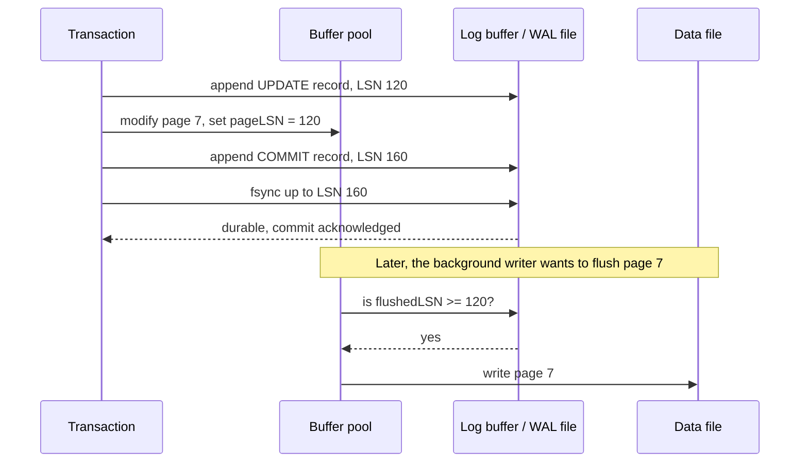

PostgreSQL's background writer and checkpointer, and InnoDB's page cleaner threads, check exactly this condition before each write. The starter's `kv` store keeps all data in memory and rebuilds it from the log, so it only needs the commit rule; the buffer pool exercise in 2.14 adds the write-ahead rule.

### 2.5 Log Record Format and LSNs

A log is an append-only file of records. Each record needs to be found, verified and applied, so its frame carries a length and a checksum. The **log sequence number** (LSN) identifies a record; in the starter, as in PostgreSQL, it is simply the byte offset where the record starts, so LSNs increase monotonically and "flushed up to LSN X" means "the first X bytes are durable".

```text
+-------------+-------------+-----------------------------------------+
| crc32c (4B) | length (4B) | payload: op (1B) | varint klen | key |   |
|             |             |          varint vlen | value            |
+-------------+-------------+-----------------------------------------+
^ LSN = byte offset of this frame
```

`Append` in `internal/wal/wal.go`:

```go
func (l *Log) Append(payload []byte) (int64, error) {
	if len(payload) > MaxRecord {
		return 0, ErrTooLarge
	}
	frame := make([]byte, frameHeader+len(payload))
	le.PutUint32(frame[4:8], uint32(len(payload)))
	copy(frame[frameHeader:], payload)
	le.PutUint32(frame[0:4], checksum(frame[4:8], payload))

	l.mu.Lock()
	defer l.mu.Unlock()
	if l.err != nil {
		return 0, l.err
	}
	lsn := l.size
	if _, err := l.f.WriteAt(frame, lsn); err != nil {
		l.err = fmt.Errorf("wal: write failed, log is read-only: %w", err)
		return 0, l.err
	}
	l.size += int64(len(frame))
	return lsn, nil
}
```

| Line / API | Role | What happens at runtime |
| :--- | :--- | :--- |
| `MaxRecord` (16 MiB) | Sanity bound | Recovery uses the same bound to reject a garbage length instead of allocating gigabytes. |
| Frame built before `l.mu.Lock()` | Short critical section | Allocation, copy and CRC happen outside the lock; only the offset assignment and the write are serialised. |
| `checksum(length, payload)` | CRC32C (Castagnoli) | Detects torn and corrupted frames. Castagnoli has hardware support on x86 (SSE 4.2) and ARMv8; PostgreSQL, RocksDB, ext4 and iSCSI use the same polynomial. Covering the length too means a corrupt length is caught. |
| `lsn := l.size` | LSN assignment | The record's LSN is the current end of the log. Assigning it under the lock gives a total order. |
| `l.f.WriteAt(frame, lsn)` | `pwrite` | Copies into the page cache. Not durable yet; see `SyncTo`. |
| `l.err = ...` (sticky) | Fail-stop | After a write error the log's on-disk state is unknown, so every later call fails until restart and recovery. |

**What goes in the payload?** There are three families of log record content:

| Style | Record says | Example | Trade-off |
| --- | --- | --- | --- |
| Physical | "bytes 200-240 of page 7 are now X" | Full-page images | Simple, idempotent redo; large records |
| Logical | "insert row (5, 'Ada') into `users`" | MySQL row-based binlog, the starter's `put key value` | Compact; redo needs a consistent database state and is not idempotent on its own |
| Physiological | "on page 7, insert this tuple at slot 3" | PostgreSQL WAL, InnoDB redo, ARIES | Physical to a page, logical within it. Each record touches exactly one page, so pages can be redone independently, and the page LSN makes redo idempotent. |

The starter logs logical operations because its whole state is rebuilt from the log on start. A page-based engine must log physiologically, otherwise it cannot tell which changes a given page on disk already contains.

### 2.6 Group Commit

If each commit pays for its own `fsync`, throughput is capped at `1 / fsync latency`: about 1,000 commits per second at 1 ms, regardless of how many cores you have. **Group commit** lets one `fsync` make many transactions durable. While one `fsync` is in progress, other transactions append their records and wait; the next `fsync` covers all of them.

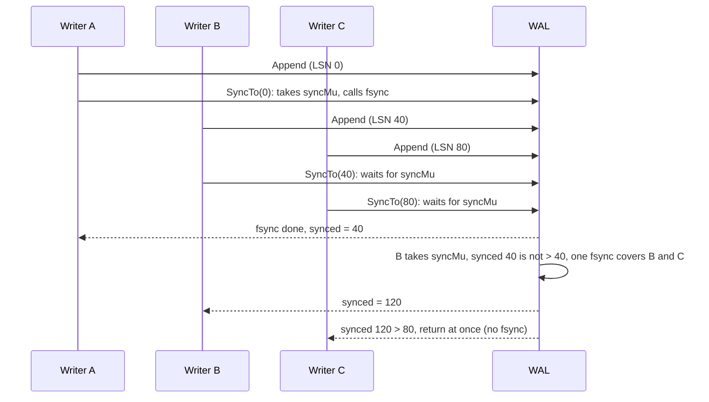

`SyncTo` in `internal/wal/wal.go`:

```go
func (l *Log) SyncTo(lsn int64) error {
	l.syncMu.Lock()
	defer l.syncMu.Unlock()
	if l.synced > lsn {
		return nil // an earlier fsync already covered this record
	}
	l.mu.Lock()
	if l.err != nil {
		err := l.err
		l.mu.Unlock()
		return err
	}
	target := l.size
	l.mu.Unlock()

	l.syncs.Add(1)
	if err := l.f.Sync(); err != nil {
		l.mu.Lock()
		l.err = fmt.Errorf("wal: fsync failed, log is read-only: %w", err)
		l.mu.Unlock()
		return err
	}
	l.synced = target
	return nil
}
```

| Line / API | Role | What happens at runtime |
| :--- | :--- | :--- |
| `syncMu` | One fsync at a time | Writers that arrive during an `fsync` queue here instead of issuing their own. |
| `if l.synced > lsn` | The group | When a queued writer gets the lock, a previous `fsync` may already have covered its record. It returns without touching the disk. |
| `target := l.size` read before `Sync` | Coverage | Every byte below `target` was written by a completed `WriteAt`, so this `fsync` makes all of it durable, including records from writers still waiting on `syncMu`. |
| `l.mu` released before `Sync` | Appends continue | New records can be appended while the `fsync` runs. They are covered by the next one. |
| `l.err` on `Sync` failure | No retry | See 1.4: a second `fsync` might succeed even though data was lost. |

`TestGroupCommit` runs 16 goroutines that each commit 25 records. A typical run on a laptop SSD prints:

```text
wal_test.go:115: 400 commits needed 50 fsyncs
```

The starter's `kv.Store.write` appends and updates the index under its own mutex (so log order and index order agree) and calls `SyncTo` after releasing it, so concurrent `PUT` requests share `fsync`s the same way.

Production engines expose the same trade-off as settings:

| Setting | Engine | Effect |
| --- | --- | --- |
| `commit_delay` (µs) + `commit_siblings` | PostgreSQL | Before flushing, wait up to `commit_delay` if at least `commit_siblings` other transactions are active, so more commits join the group. Off (0) by default. |
| `synchronous_commit = off` | PostgreSQL | Commit returns before the WAL flush. A crash can lose roughly the last `3 × wal_writer_delay` (600 ms by default) of commits, but never corrupts data. Can be set per transaction. |
| `innodb_flush_log_at_trx_commit = 1 / 2 / 0` | InnoDB | 1: flush at every commit (default, durable). 2: write to the OS at commit, flush about once per second (survives a mysqld crash, not an OS crash). 0: write and flush about once per second. |
| `binlog_group_commit_sync_delay` | MySQL | Same idea as `commit_delay` for the binary log. |
| `Options.NoSync` | Starter | Skips `SyncTo`; the log is synced on `Close`. |

### 2.7 Redo Recovery and the Torn Tail

On start-up, the engine must reach a state that contains every committed change and nothing else. The starter's store has no pages on disk, so recovery is: read the log from the beginning and reapply every intact record.

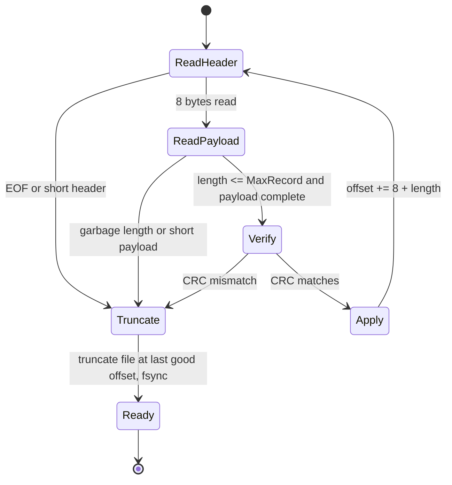

The core of `scan` in `internal/wal/wal.go`:

```go
for {
	if _, err := io.ReadFull(r, hdr[:]); err != nil {
		if errors.Is(err, io.EOF) || errors.Is(err, io.ErrUnexpectedEOF) {
			return off, nil
		}
		return 0, err
	}
	sum, n := le.Uint32(hdr[0:4]), le.Uint32(hdr[4:8])
	if n > MaxRecord {
		return off, nil // garbage length: torn or never-written frame
	}
	payload := make([]byte, n)
	if _, err := io.ReadFull(r, payload); err != nil {
		if errors.Is(err, io.EOF) || errors.Is(err, io.ErrUnexpectedEOF) {
			return off, nil
		}
		return 0, err
	}
	if checksum(hdr[4:8], payload) != sum {
		return off, nil
	}
	if apply != nil {
		if err := apply(off, payload); err != nil {
			return 0, fmt.Errorf("wal: apply record at LSN %d: %w", off, err)
		}
	}
	off += frameHeader + int64(n)
}
```

| Line / API | Role | What happens at runtime |
| :--- | :--- | :--- |
| `io.ErrUnexpectedEOF` → `return off` | Torn tail | The process died in the middle of writing a frame. Everything from `off` on is discarded. |
| `n > MaxRecord` → `return off` | Garbage header | Bytes past the real end of the log can be anything (preallocated zeros are fine, old data is not). A nonsense length ends the log. |
| CRC mismatch → `return off` | Corrupt or partial frame | Same treatment. See the trade-off below. |
| `apply(off, payload)` | Redo | `kv.Store.redo` decodes the operation and applies it to the B+ tree. An error here is a real bug (unknown op), not a torn write, so recovery fails loudly. |
| Real read error → `return 0, err` | I/O failure | An `EIO` is not "end of log"; refusing to start is safer than truncating good data. |

After `scan`, `Open` truncates the file at the last good offset and fsyncs. Without the truncation, new records would be appended after the garbage, and the *next* recovery would stop at the garbage and silently drop them. `TestTornTailIsTruncated` checks exactly that sequence.

**The trade-off.** Treating the first bad frame as the end of the log is right for the tail, where a torn write is expected. A bad frame in the *middle* of the log is different: it means real corruption, and everything after it, including committed transactions, is dropped. PostgreSQL makes the same choice for the end of WAL and relies on WAL segment headers, page checksums and backups to catch mid-log damage. RocksDB exposes the choice as `WALRecoveryMode` (`kTolerateCorruptedTailRecords`, `kAbsoluteConsistency`, `kPointInTimeRecovery`, `kSkipAnyCorruptedRecords`).

### 2.8 ARIES: Analysis, Redo, Undo

Rebuilding everything from the log only works when the log is the whole database. A page-based engine with steal + no-force has dirty pages on disk from uncommitted transactions and missing pages from committed ones. **ARIES** (Mohan et al., IBM, 1992) is the recovery algorithm most such engines follow, and it rests on three ideas:

1. **Write-ahead logging** with an LSN on every page.
2. **Repeating history during redo**: redo *every* logged change, including those of transactions that will be rolled back, to bring the database to its exact state at the crash. Then undo the losers.
3. **Logging changes during undo**: every undo step writes a **compensation log record** (CLR) that points at the next record to undo, so a crash during recovery never undoes the same change twice.

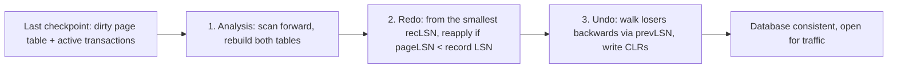

| Phase | Reads | Produces | Key rule |
| --- | --- | --- | --- |
| Analysis | Log from the last checkpoint to the end | **Transaction table** (active transactions and their last LSN) and **dirty page table** (each dirty page and its recLSN, the first LSN that dirtied it) | Transactions with a commit record are winners; the rest are losers. |
| Redo | Log from the smallest recLSN forward | Pages as they were at the crash | Skip a record if the page is not in the dirty page table, if its recLSN is larger, or if the page's on-disk pageLSN is already >= the record's LSN. This makes redo idempotent. |
| Undo | Loser records, newest first, following each transaction's prevLSN chain | Rolled-back pages and CLRs | CLRs are redo-only and carry `undoNextLSN`, so a second crash resumes undo where it stopped. |

How the big engines map onto it:

- **InnoDB** is close to textbook: a redo log (`#innodb_redo` files in 8.0.30+) for physiological page changes, and **undo logs** in undo tablespaces that hold the old versions of rows. Undo records serve two purposes: rolling back losers after a crash and building old row versions for MVCC reads.
- **PostgreSQL** is **redo-only**. It never needs to undo heap changes, because an aborted transaction's tuple versions are simply invisible: visibility checks consult the commit log (`pg_xact`) and see that the inserting transaction aborted. VACUUM cleans the dead versions up later. This makes recovery simpler and rollback instant, at the cost of table bloat (Stage 4 and M3).
- **SQLite** in rollback-journal mode writes the *old* page images to a journal before changing the database file (undo logging, force at commit). In WAL mode it appends *new* page images to the `-wal` file and copies them back at checkpoint (redo logging).

M1 builds ARIES recovery end to end on top of the starter's buffer pool.

### 2.9 Checkpoints and Log Truncation

Without checkpoints, the log grows forever and recovery replays all of it. The starter project has exactly this limitation: restart time grows with every write ever made. A **checkpoint** bounds both.

| Kind | What happens | Downside |
| --- | --- | --- |
| Sharp (consistent) | Stop new transactions, flush every dirty page, write a checkpoint record | Stalls the whole database for the length of the flush |
| Fuzzy | Write a begin-checkpoint record with the dirty page table and transaction table, keep running, flush pages in the background, write end-checkpoint | Recovery must start from the oldest recLSN in that dirty page table, which can be before the checkpoint record |

PostgreSQL's checkpointer runs a fuzzy checkpoint every `checkpoint_timeout` (5 min by default) or when `max_wal_size` (1 GB by default) of WAL has been written since the last one, whichever comes first. It notes the current WAL position as the **REDO point**, writes out every page that was dirty at that moment, spreading the writes over `checkpoint_completion_target` (0.9) of the interval, and finally records the REDO point in `pg_control`. Recovery starts there, and WAL segments older than the REDO point can be recycled (once replicas and archiving no longer need them).

The tuning trade-off is direct:

| Longer interval (`checkpoint_timeout` up, `max_wal_size` up) | Shorter interval |
| --- | --- |
| Fewer full-page images (2.10), less WAL, less write I/O | More full-page images, more WAL volume |
| A page modified many times is written once | Hot pages are written repeatedly |
| Longer crash recovery (more WAL to replay) | Faster crash recovery |
| More disk space for `pg_wal` | Less disk space |

If `pg_stat_checkpointer.num_requested` (PostgreSQL 17+; `pg_stat_bgwriter.checkpoints_req` before 17) grows faster than `num_timed`, checkpoints are being forced by WAL volume and `max_wal_size` is too small for the write rate. The server log also says so: `LOG: checkpoints are occurring too frequently (12 seconds apart)`.

### 2.10 Torn Pages, Full-Page Writes and Checksums

Recall from 1.4 that an 8 KiB page write is not atomic. If power fails mid-write, the page on disk can be half old, half new: a **torn page**. Physiological redo cannot fix that, because applying "insert tuple at slot 3" to a page whose header belongs to one version and whose body belongs to another produces garbage.

Engines solve it in one of three ways:

| Technique | How it works | Cost |
| --- | --- | --- |
| Full-page writes (PostgreSQL `full_page_writes = on`) | The first time a page is changed after a checkpoint, the WAL record carries a complete image of the page. Redo restores the image, then applies later records. | More WAL right after each checkpoint. `wal_compression` (lz4, zstd) shrinks the images. |
| Doublewrite buffer (InnoDB) | Pages are first written to a doublewrite area and fsynced, then written to their real location. On recovery a torn page is repaired from the doublewrite copy. | Every page is written twice (sequentially to the doublewrite area). |
| Atomic writes from below | ZFS (copy-on-write), some NVMe drives with atomic write units of 16 KiB or more, or a page size equal to the guaranteed atomic unit | Hardware or file-system dependent. Only disable full-page writes or doublewrite if you can prove the guarantee. |

The effect is visible in [`sql/02-wal.sql`](sql/02-wal.sql), which runs the same 100-row `UPDATE` twice right after a `CHECKPOINT`:

```text
 bytes_first_update
--------------------
              34216

 bytes_second_update
---------------------
               13912
```

The first update logs full images of every page it touches; the second logs only the tuple changes. That 2.5x difference is the WAL cost of torn-page protection, and it is why very short checkpoint intervals inflate WAL volume.

**Checksums** detect a different problem: pages corrupted by the disk, the controller, the file system or a kernel bug. With data checksums on (the default from PostgreSQL 18), every page carries a 16-bit checksum that is verified on read. A mismatch raises `ERROR: invalid page in block 1234 of relation base/16384/16385` instead of returning wrong rows. InnoDB checksums every page with CRC32C (`innodb_checksum_algorithm = crc32`).

### 2.11 Watching the WAL in PostgreSQL

[`sql/02-wal.sql`](sql/02-wal.sql) measures WAL generation from SQL:

```sql
SELECT pg_current_wal_lsn() AS lsn, pg_walfile_name(pg_current_wal_lsn()) AS segment;

CREATE TEMP TABLE s2_mark AS SELECT pg_current_wal_lsn() AS before;
INSERT INTO s2_events SELECT g, repeat('x', 100) FROM generate_series(1, 10000) AS g;
SELECT pg_size_pretty(pg_wal_lsn_diff(pg_current_wal_lsn(), before)) AS wal_generated
FROM s2_mark;
```

```text
    lsn    |         segment
-----------+--------------------------
 0/15F79A0 | 000000010000000000000001

 wal_generated
---------------
 1703 kB
```

| Function / object | What it tells you |
| --- | --- |
| `pg_current_wal_lsn()` | Current insert position. An LSN such as `0/15F79A0` is a 64-bit byte position written as two hex halves. |
| `pg_walfile_name(lsn)` | The 16 MiB segment file in `pg_wal/` that holds that position: timeline (8 hex digits), then the segment number. |
| `pg_wal_lsn_diff(a, b)` | Bytes of WAL between two positions. 10,000 rows of ~130 bytes produced 1.7 MB of WAL here: tuple data plus per-record headers. |
| `pg_stat_wal` | Cumulative WAL records, full-page images (`wal_fpi`) and bytes since the last stats reset. |
| `pg_waldump` | Command-line decoder for WAL segments. |

To see the records themselves, run `pg_waldump` on the server (or inside the container):

```bash
# Summary by record type for one segment
pg_waldump --stats=record "$PGDATA/pg_wal/000000010000000000000001"

# Every record in a range of LSNs, with full-page images flagged as FPW
pg_waldump -p "$PGDATA/pg_wal" -s 0/15F79A0 -e 0/1600000 | head -20
```

A line of output reads like `rmgr: Heap len (rec/tot): 59/59, tx: 747, lsn: 0/015F79D8, prev 0/015F79A0, desc: INSERT off: 3 flags: 0x00, blkref #0: rel 1663/5/16422 blk 0`. Reading it left to right: the resource manager (which subsystem's redo function applies it), record length, transaction, this record's LSN, the previous record's LSN, a description, and the block it applies to. That is a physiological record: one page, one logical operation on it.

### 2.12 Pitfalls

| Pitfall | Symptom | Fix |
| --- | --- | --- |
| Appending after a torn tail without truncating it | Records written after a crash disappear at the next restart | Truncate at the last valid frame during recovery, then fsync (`wal.Open`) |
| Treating any read error during recovery as end-of-log | An `EIO` on a bad sector silently truncates committed transactions | Only short reads and checksum failures mean "end"; propagate real I/O errors |
| Writing a dirty page before its log records are durable | After a crash, a page contains a change whose log record is missing; undo is impossible, data is inconsistent | Check `flushedLSN >= pageLSN` before every page write |
| Pin leak (Fetch without Unpin on an error path) | Pool slowly fills with pinned frames, then `ErrNoFreeFrame` / PostgreSQL `no unpinned buffers available` | `defer pool.Unpin(...)` right after a successful `Fetch`; count pins in tests |
| One `fsync` per commit on a consumer SSD | Write throughput stuck at a few hundred transactions/s while CPU and disk bandwidth are idle | Group commit; drives with power-loss protection; `synchronous_commit = off` for data you can afford to lose |
| `max_wal_size` too small | `LOG: checkpoints are occurring too frequently`; WAL volume spikes from full-page images | Raise `max_wal_size` until checkpoints are mostly timed |
| Turning off `full_page_writes` or the doublewrite buffer for speed | Unrecoverable torn pages after a power loss: `invalid page in block`, or silent corruption without checksums | Leave them on unless the storage stack guarantees atomic page writes |
| Recovery without checkpoints | Restart time grows with total write history (the starter's current behaviour) | Checkpoint and truncate the log (exercise below and M1) |
| Using `fsync = off` in production | Fast until the first crash, then a corrupted cluster | Only for throwaway test clusters; use `synchronous_commit = off` if you want to trade durability for speed safely |

### 2.13 Best Practices

- **Log first, always**: no page reaches disk and no client hears "committed" before the log says so.
- **Checksum every log frame and include the length in the checksum**: a corrupt length must not pass as a valid record.
- **Make recovery idempotent**: page LSNs (or a redo-from-scratch design like the starter) mean a crash during recovery is harmless.
- **Keep the commit path short**: build the record outside the lock, serialise only the append, and fsync outside both.
- **Test recovery, not just the happy path**: truncate and corrupt log files in tests (`TestTornTailIsTruncated`, `TestChecksumStopsReplay`), and kill a VM during writes in staging.
- **Watch checkpoint and WAL metrics**: `pg_stat_checkpointer`, `pg_stat_wal.wal_fpi` and InnoDB's checkpoint age tell you when write I/O is about to spike.
- **Choose durability per workload, explicitly**: `synchronous_commit = off` on a session that loads analytics data is a sound decision; `fsync = off` on a server is not.

### 2.14 Hands-on Exercise

**Task.** Give the starter's `kv` store a checkpoint so that recovery time stops growing with history.

1. Add `func (s *Store) Checkpoint() error`. Under the write lock, write every key/value in the B+ tree to `snapshot.db` in `record` format, using `fsutil.WriteFileAtomic`. Then start a new, empty WAL file (`wal.log` replaced by a fresh one) and sync the directory.
2. Change `Open` to load `snapshot.db` (if present) into the index *before* replaying `wal.log`.
3. Think about the crash windows: crash after the snapshot is written but before the WAL is reset, and crash after the WAL is reset. Both must recover every key. (Replaying a log whose operations are already in the snapshot is harmless here because `put` and `delete` of whole keys are idempotent.)

**Tests to write** in `internal/kv/kv_test.go`: put 1,000 keys, checkpoint, put 10 more, close, reopen, check all 1,010; and check that `LogSize()` after reopening is the size of 10 records, not 1,010.

**Expected output.**

```text
$ go test -run Checkpoint -v ./internal/kv
=== RUN   TestCheckpointBoundsLog
--- PASS: TestCheckpointBoundsLog
PASS
```

**Where the pieces are.** `fsutil.WriteFileAtomic` (`internal/fsutil/atomic.go`) does the crash-safe snapshot write; `record.Append` and `record.Decode` (`internal/record`) give you the format; `kv.Open` and `kv.redo` (`internal/kv/kv.go`) show where loading fits. M1 extends this to a fuzzy checkpoint over the page-based buffer pool.

[Back to top ⤴️](#-table-of-contents)

---

## 3. Stage 3: Indexing: B+ Trees, Hash Indexes & LSM Trees

An index turns "read every page" into "read three or four pages". This stage builds the two structures that dominate storage engines, the B+ tree and the log-structured merge tree, plus hash indexes and Bloom filters, and shows how to pick between them. It assumes Stages 1 and 2. By the end you can derive a B+ tree's height from its page size, trace a split, explain why an LSM tree writes faster and reads slower, and read PostgreSQL's index internals.

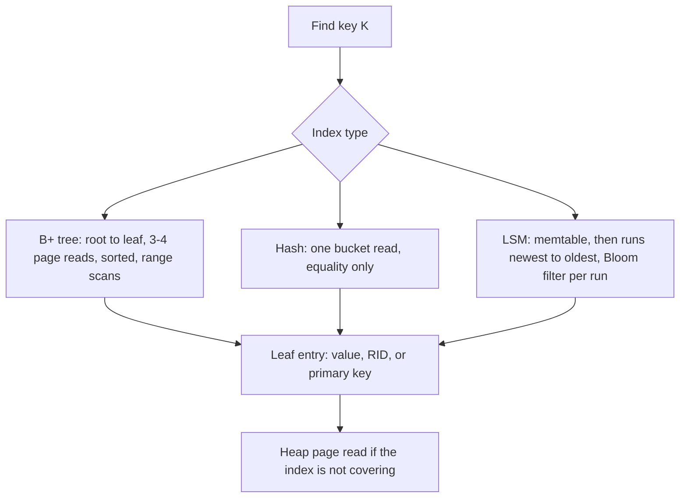

### 3.1 Access Paths and Selectivity

An **access path** is the way the executor gets rows out of a table. Which one is cheapest depends on **selectivity**: the fraction of rows the predicate keeps.

| Access path | Pages read | Best when |
| --- | --- | --- |
| Sequential scan | Every page, in order (fast sequential I/O, read-ahead) | Selectivity above roughly 5-10%, small tables, or no usable index |
| Index scan | Index height + one heap page per matching row (random I/O) | Few matching rows |
| Bitmap index scan + bitmap heap scan (PostgreSQL) | Index pages, then each matching heap page once, in physical order | Moderate selectivity: too many rows for an index scan, too few for a seq scan |
| Index-only scan | Index pages only, when every needed column is in the index and pages are all-visible | Covering indexes (3.10) |

The crossover is earlier than most people expect. Reading 1% of a 1-million-row table through an index costs about 10,000 random heap page reads; a sequential scan of the same table might be 10,000 pages in total, read sequentially. [`sql/03-indexes.sql`](sql/03-indexes.sql) shows PostgreSQL making this choice on a 200,000-row table:

```text
 Index Scan using s3_orders_pkey on s3_orders            -- WHERE id = 42: one row
 Index Only Scan using s3_orders_customer on s3_orders   -- WHERE customer_id = 7: covered
 Seq Scan on s3_orders  Filter: (status = 'paid'::text)  -- one third of the table
```

Stage 5 covers how the planner estimates selectivity; this stage is about the structures it chooses between.

### 3.2 B+ Tree Structure and Fanout

A **B+ tree** is a balanced search tree whose nodes are pages.

- **Leaves** hold the keys and their values (or RIDs) in sorted order, and each leaf links to its right sibling so range scans walk sideways without going back up.
- **Internal nodes** hold only separator keys and child pointers. A node with *k* keys has *k*+1 children; child *i* holds keys in `[keys[i-1], keys[i])`.
- **Every leaf is at the same depth**, because the tree only grows at the root.

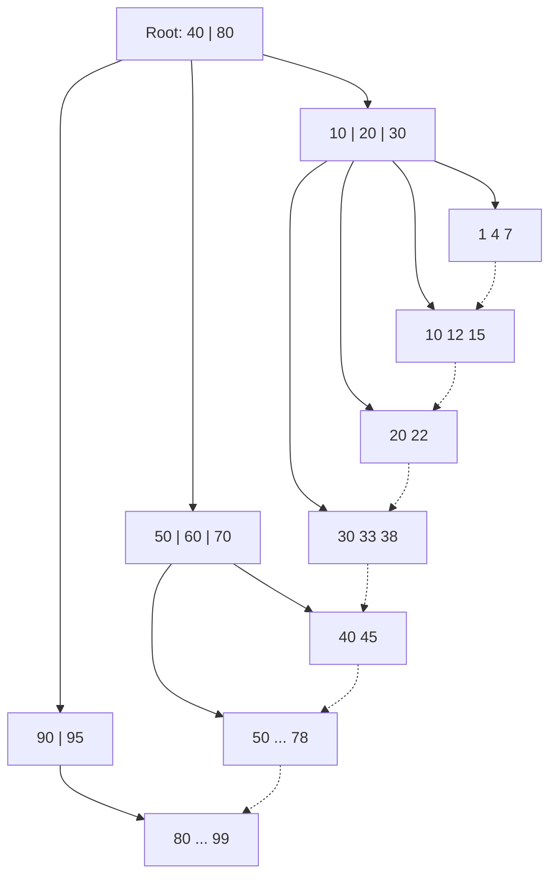

The number that matters is **fanout**: how many children fit in one internal page. With 8 KiB pages and 16-byte entries (an 8-byte key, a 6-byte pointer, 2 bytes overhead), an internal page holds about 500 entries. Height grows with the logarithm of the row count to that base:

| Fanout | Height 2 | Height 3 | Height 4 |
| --- | --- | --- | --- |
| 100 | 10,000 keys | 1 million | 100 million |
| 500 | 250,000 | 125 million | 62.5 billion |

So a lookup among 100 million rows reads 4 pages, and the top two or three levels are almost always in the buffer pool, so in practice it costs one or two disk reads. The PostgreSQL walkthrough confirms it: the 200,000-row primary key has `level = 2` (root, one internal level, leaves), 547 leaf pages, and about 367 entries per leaf.

**Wider keys cost height.** A 36-byte UUID string instead of an 8-byte integer cuts fanout by roughly 3x. That is why compact keys (integers, binary `uuid` rather than `text`) and **suffix truncation** of separators (InnoDB and PostgreSQL 12+ keep only enough of a separator key to tell the children apart) pay off.

### 3.3 Search, Insert and Node Splits

**Search** descends from the root: in each internal node, binary-search for the child whose range contains the key; in the leaf, binary-search for the key. From `internal/btree/btree.go`:

```go
// childIndex picks the child whose key range contains k. children[i] holds
// keys in [keys[i-1], keys[i]).
func childIndex(n *node, k []byte) int {
	return sort.Search(len(n.keys), func(i int) bool { return bytes.Compare(k, n.keys[i]) < 0 })
}

func (t *Tree) findLeaf(k []byte) *node {
	n := t.root
	for !n.leaf {
		n = n.children[childIndex(n, k)]
	}
	return n
}
```

**Insert** finds the leaf and adds the key in sorted position. If the leaf now has more than `maxKeys` keys, it **splits**: the upper half moves to a new right sibling, and a separator goes up to the parent. If the parent overflows, it splits too, and so on up to the root. A root split creates a new root, and that is the only way the tree gets taller.

```go
func (t *Tree) insert(n *node, k, v []byte) (sep []byte, right *node, added bool) {
	if n.leaf {
		i := lowerBound(n, k)
		if i < len(n.keys) && bytes.Equal(n.keys[i], k) {
			n.vals[i] = v
			return nil, nil, false
		}
		n.keys = slices.Insert(n.keys, i, k)
		n.vals = slices.Insert(n.vals, i, v)
		if len(n.keys) > t.maxKeys {
			sep, right = splitLeaf(n)
		}
		return sep, right, true
	}
	i := childIndex(n, k)
	s, r, added := t.insert(n.children[i], k, v)
	if r != nil {
		n.keys = slices.Insert(n.keys, i, s)
		n.children = slices.Insert(n.children, i+1, r)
		if len(n.keys) > t.maxKeys {
			sep, right = splitInternal(n)
		}
	}
	return sep, right, added
}
```

| Line / API | Role | What happens at runtime |
| :--- | :--- | :--- |
| `lowerBound` then `bytes.Equal` | Upsert | An existing key gets its value replaced in place; the tree's shape does not change. |
| `slices.Insert(n.keys, i, k)` | Sorted insert | Shifts later keys right. On a disk page this is the `memmove` inside a slotted page. |
| `len(n.keys) > t.maxKeys` | Overflow | With pages, the test is "does the new entry fit in the free space". |
| Recursion returns `(sep, right)` | Split propagation | The caller inserts the separator and the new child pointer at position `i` / `i+1`, which can overflow the caller in turn. |
| Root split in `Put` | Growth | `t.root = &node{keys: [][]byte{sep}, children: []*node{t.root, right}}` adds one level above everything. |

The two splits differ in one detail, which is the whole difference between a B tree and a B+ tree:

```go
// splitLeaf: the first key of the new leaf is COPIED up.
right := &node{leaf: true, keys: slices.Clone(n.keys[mid:]), vals: slices.Clone(n.vals[mid:]), next: n.next}
n.keys, n.vals = n.keys[:mid], n.vals[:mid]
n.next = right
return right.keys[0], right

// splitInternal: the middle key is PUSHED up and removed from both halves.
sep := n.keys[mid]
right := &node{keys: slices.Clone(n.keys[mid+1:]), children: slices.Clone(n.children[mid+1:])}
n.keys, n.children = n.keys[:mid], n.children[:mid+1]
return sep, right
```

| | Leaf split | Internal split |
| --- | --- | --- |
| Separator | Copy of the right leaf's first key | The middle key itself |
| Separator also stays below? | Yes: leaves must contain every key | No: internal keys only route |
| Sibling link | `right.next = n.next; n.next = right` | None in this implementation (B-link trees add one, 3.5) |

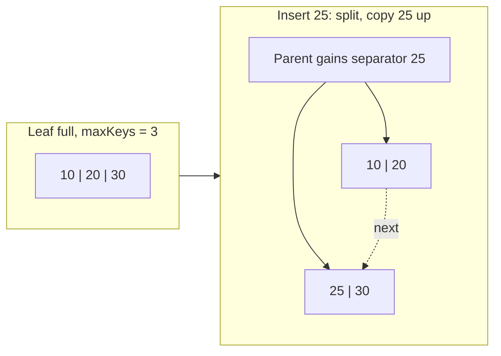

`TestAgainstMap` checks the implementation against a Go map with 5,000 random puts and deletes at `maxKeys` of 3, 4, 7 and 64, and after every run verifies the invariants: keys sorted within each node, every key inside its parent's bounds, every leaf at the same depth, and no node over `maxKeys`. `TestHeightIsLogarithmic` inserts 100,000 keys with fanout 64 and checks the height is at most 4.

### 3.4 Deletes, Fill Factor and Key Order

**Deletes.** The textbook B+ tree keeps every node at least half full: after a delete, an underfull node borrows from a sibling or merges with it, and merges can propagate up. Production engines mostly don't bother:

- The starter's `Delete` removes the key from its leaf and stops. Leaves can become empty; separators remain valid as routing bounds even if the key they came from is gone.
- **PostgreSQL** nbtree never merges partially empty pages. VACUUM deletes pages only when they become completely empty, and PostgreSQL 13+ **deduplicates** repeated keys in a leaf while PostgreSQL 14+ does **bottom-up deletion** of old row versions before splitting a page, which removes most of the bloat that MVCC updates cause.
- **InnoDB** merges a page with a neighbour when it drops below `MERGE_THRESHOLD` (50% by default).

The reason is cost: merging moves data and writes log records to recover space that later inserts often refill anyway. `REINDEX` (PostgreSQL) or `OPTIMIZE TABLE` (InnoDB) rebuilds a badly bloated index when it does matter.

**Fill factor.** A leaf split leaves two half-full pages. If keys arrive in increasing order, that wastes half the space: the left page is never touched again. Engines detect the rightmost-split case and split unevenly. PostgreSQL B-tree leaves are filled to `fillfactor` (90% by default) on a rightmost split; InnoDB fills sequentially-inserted pages to about 15/16. The PostgreSQL walkthrough shows the result: 367 entries and 808 free bytes per leaf, about 90% full. For a table that will receive updates in random places, a *lower* fill factor leaves room and avoids splits:

```sql
CREATE INDEX orders_by_customer ON orders (customer_id) WITH (fillfactor = 70);
```

**Key order decides the insert pattern.** Where new keys land in the index changes everything about write cost:

| Key | Where inserts land | Effect |
| --- | --- | --- |
| `bigint` identity / sequence | Always the rightmost leaf | One hot page stays in cache; PostgreSQL caches the rightmost leaf to skip the descent; splits are cheap and pages ~90% full |
| UUIDv7, ULID, Snowflake IDs | Rightmost region, ordered by time | Almost as good as a sequence, globally unique without coordination |
| UUIDv4 (`gen_random_uuid()`) | Uniformly random leaf | Every insert touches a random page: working set = whole index, constant splits, pages ~70% full on average, many full-page images in the WAL after each checkpoint |
| Hash of the key | Uniformly random | Same as UUIDv4 |

On a large table the difference between sequential and random primary keys is often several times in insert throughput and WAL volume. PostgreSQL 18's `uuidv7()` (see the Versions section) exists largely for this reason. The converse also holds: a single rightmost hot page becomes a latch contention point at very high insert rates from many threads, and that is when sharding the key or hash partitioning helps.

### 3.5 Concurrent B+ Trees: Latch Crabbing and B-link Trees

The starter's B+ tree is guarded by the store's single mutex. Real engines let many threads search and modify the tree at once, protecting each page with a short-held reader-writer latch (2.1). The difficulty is that a split changes a parent *after* a thread has already moved down past it.

**Latch crabbing** (or coupling) is the classic protocol:

- **Search**: latch the child, then release the parent. At most two latches are held, top to bottom.
- **Insert/delete, pessimistic**: take write latches going down, and release all ancestor latches as soon as the current node is **safe**, meaning it cannot split (has room for one more key) or merge (more than half full). Whatever is still held is the set of nodes a split could reach.
- **Insert, optimistic**: most inserts do not split. Descend with read latches, write-latch only the leaf; if the leaf turns out to need a split, release everything and retry pessimistically.

The problem with even optimistic crabbing is the root: every writer at least read-latches it. **B-link trees** (Lehman and Yao, 1981) remove the need for latch coupling. Every node, internal ones included, gets a right-sibling pointer and a **high key** (an upper bound on the keys in the node). A split happens in two steps: first create the right sibling and link it in, then insert the separator into the parent. A reader that arrives at a node between those steps and finds its key greater than the high key just follows the right link.

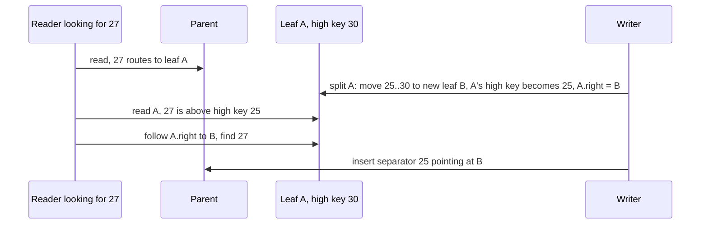

PostgreSQL's nbtree is a B-link tree (the source tree's `src/backend/access/nbtree/README` describes the details), which is why readers never block on splits there. InnoDB uses latch crabbing with an index-level latch for structure changes. Lock-free and latch-free designs (the Bw-tree in SQL Server Hekaton, optimistic lock coupling with version counters in research systems such as LeanStore) push the same idea further.

### 3.6 Hash Indexes: Static, Extendible and Linear Hashing

A hash index maps `hash(key)` to a bucket page. An equality lookup reads one bucket (plus overflow pages) regardless of table size. It cannot answer range queries, `ORDER BY` or prefix matches, because hashing destroys order.

The hard part is growth. A **static** hash table with a fixed number of buckets develops long overflow chains as the table grows, and rehashing everything at once stalls the database. Two schemes grow one bucket at a time:

| Scheme | Directory | How it grows | Cost of growth |
| --- | --- | --- | --- |
| Static | None; N fixed buckets | Overflow chains | Full rehash to resize |
| Extendible hashing | Array of 2^g pointers (g = global depth); buckets have a local depth | Split only the overflowing bucket; double the directory (pointers only) if the bucket's local depth equals g | One bucket's entries move; directory doubling copies pointers, not data |
| Linear hashing | None; a split pointer moves round-robin through the buckets | When the load factor passes a threshold, split the bucket at the split pointer (not necessarily the full one) and advance the pointer | One bucket per step, predictable; overflowing buckets wait their turn |

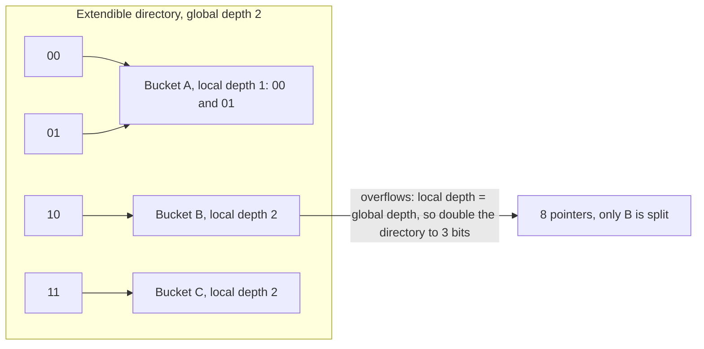

**In practice.** PostgreSQL has hash indexes; they are WAL-logged and crash-safe since PostgreSQL 10 and can be smaller and faster than a B-tree for equality on long keys (they store only the 4-byte hash), but a B-tree is the right default because it also serves ranges, sorting and uniqueness. InnoDB builds an **adaptive hash index** automatically over hot B-tree pages, though MySQL 8.4 turns it off by default because its latch becomes a contention point. Hash structures dominate in memory: hash joins (Stage 5), Redis, and the page table inside every buffer pool (the starter's `map[PageID]int`).

### 3.7 LSM Trees: Memtable, Runs and Merge

A B+ tree updates pages in place, so a random write costs a random page read plus, eventually, a random page write. A **log-structured merge tree** (O'Neil et al., 1996) never updates in place:

1. A write goes to the **WAL** (for durability) and to the **memtable**, a sorted in-memory structure (a skip list in RocksDB, a B-tree here).
2. When the memtable is full, it is written out as an immutable sorted file, an **SSTable** (sorted string table), in one sequential write.
3. A read checks the memtable, then SSTables from newest to oldest; the first match wins.
4. In the background, **compaction** merges SSTables, discarding overwritten values and deleted keys, so the number of files a read must check stays bounded.

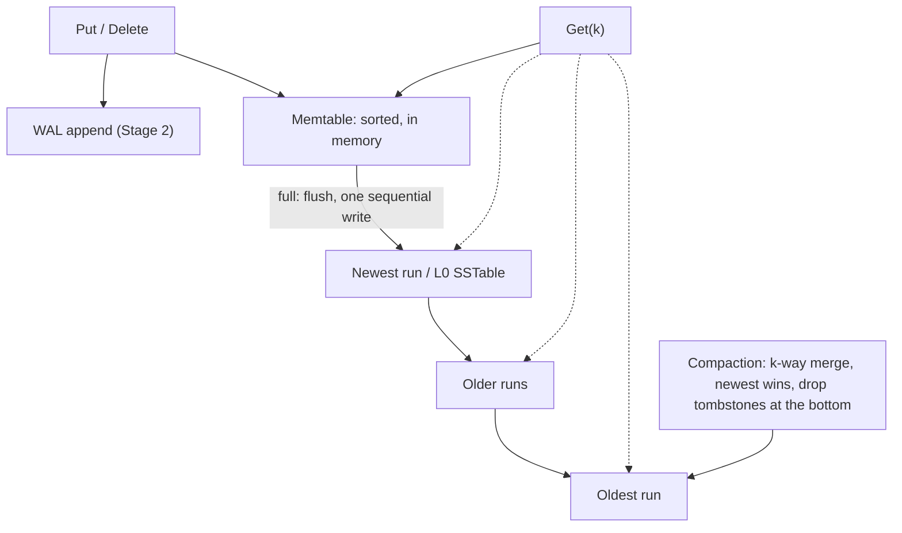

A delete cannot remove a key from an immutable file, so it writes a **tombstone**: a marker that says "this key is deleted as of now". Reads that hit the tombstone stop and report "not found". The tombstone can be dropped only when compaction reaches the oldest data, because before that an older run may still contain the key.

The starter's `internal/lsm` keeps everything in memory so that each step is visible. `Get`:

```go
func (t *Tree) Get(k []byte) ([]byte, bool) {
	if tagged, ok := t.mem.Get(k); ok {
		if tagged[0] == tombstone {
			return nil, false
		}
		return tagged[1:], true
	}
	for _, r := range t.runs {
		if !r.filter.MayContain(k) {
			t.stats.FilterSkips++
			continue
		}
		t.stats.RunProbes++
		if e, ok := r.find(k); ok {
			if e.deleted {
				return nil, false
			}
			return e.value, true
		}
	}
	return nil, false
}
```

And the merge at the heart of compaction, a k-way merge over sorted runs with a heap:

```go
func merge(runs []*run, dropTombstones bool) []entry {
	h := &mergeHeap{runs: runs}
	for i, r := range runs {
		if len(r.entries) > 0 {
			h.cur = append(h.cur, cursor{run: i})
		}
	}
	heap.Init(h)
	var out []entry
	var last []byte
	first := true
	for h.Len() > 0 {
		c := h.cur[0]
		e := runs[c.run].entries[c.pos]
		if first || !bytes.Equal(e.key, last) {
			first, last = false, e.key
			if !(dropTombstones && e.deleted) {
				out = append(out, e)
			}
		}
		if c.pos+1 < len(runs[c.run].entries) {
			h.cur[0].pos++
			heap.Fix(h, 0)
		} else {
			heap.Pop(h)
		}
	}
	return out
}
```

| Line / API | Role | What happens at runtime |
| :--- | :--- | :--- |
| Memtable value tagged with `live` / `tombstone` byte | Deletes as writes | `Delete` is a `Put` of a 1-byte tombstone. |
| `for _, r := range t.runs` (newest first) | Read path | Each run is a possible extra I/O in a disk LSM. This loop is read amplification made visible. |
| `r.filter.MayContain(k)` | Bloom filter | Skips runs that cannot hold the key (3.9). |
| `mergeHeap.Less`: key, then run index | Newest wins | For equal keys, the entry from the lower run index (newer) comes out first; later duplicates are skipped by the `last` check. |
| `dropTombstones` | Space reclamation | Safe only when the merge output is the oldest data. Merging only the newer runs must keep tombstones, or a deleted key would reappear from an older run. |
| `heap.Fix(h, 0)` | O(log k) per entry | Merging k runs of n total entries costs O(n log k), all sequential reads and one sequential write. |

`TestAgainstMap` runs 20,000 random puts and deletes with a 2 KiB memtable and `MaxRuns: 3`, which forces many flushes and compactions, and checks every key against a Go map. `TestTombstoneShadowsOlderRun` checks that a tombstone hides an older value and that full compaction removes both.

### 3.8 Compaction Strategies and Amplification

Every index structure pays in three currencies. The **RUM conjecture** (Athanassoulis et al., 2016) says you can optimise any two of Read, Update and Memory (space) overhead at the expense of the third.

| Metric | Definition | B+ tree | LSM, leveled | LSM, size-tiered |
| --- | --- | --- | --- | --- |
| Write amplification | Bytes written to disk / bytes written by the application | High for small random updates: a 100-byte change rewrites an 8 KiB page (plus WAL, plus full-page image) | ~10-30x: each byte is rewritten once per level | Lower, ~4-10x |
| Read amplification | Pages read per point lookup | ~1-2 (upper levels cached) | ~1 per level that the Bloom filter lets through; usually 1-2 | Higher: many overlapping runs |
| Space amplification | Bytes on disk / bytes of live data | ~1.3-1.5x (fill factor, fragmentation) | ~1.1x | Up to 2x or more during compaction |

**Leveled compaction** (LevelDB, RocksDB default): L0 holds freshly flushed files that may overlap. From L1 down, each level is one sorted, non-overlapping run split into many files, and each level is about 10x the size of the previous one (`max_bytes_for_level_multiplier = 10`). When a level exceeds its target, one file from it is merged with the overlapping files of the next level. Reads touch at most one file per level; writes pay for the rewriting.

**Size-tiered compaction** (Cassandra's STCS, RocksDB "universal"): when several runs of similar size accumulate, merge them into one bigger run. Fewer rewrites, more runs to check on reads, and a full merge temporarily needs as much free space as the data.

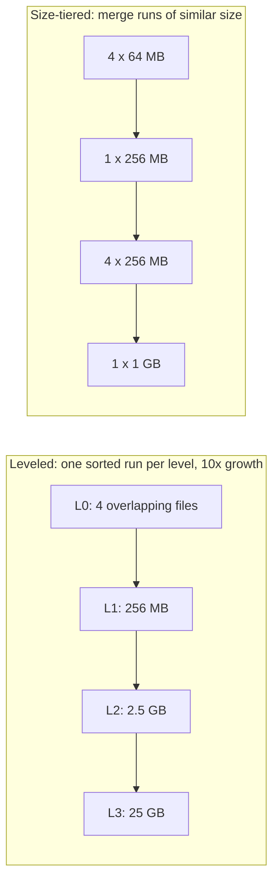

The starter's `Compact` is the simplest possible policy: merge every run into one when there are more than `MaxRuns`. That gives excellent reads and terrible write amplification for large data, which is the right starting point for M2, where you implement leveled compaction and measure the difference.

**Write stalls** are the LSM failure mode to know: if compaction cannot keep up with the write rate, L0 files pile up, reads slow down, and RocksDB deliberately slows (`level0_slowdown_writes_trigger`) and then stops (`level0_stop_writes_trigger`) writes until compaction catches up. The fix is more compaction threads, a bigger memtable, or a compaction style with lower write amplification.

### 3.9 Bloom Filters

A Bloom filter answers "is key K in this set?" with "definitely not" or "maybe", using a bit array of *m* bits and *k* hash functions. Adding a key sets *k* bits; a query checks those *k* bits and answers "maybe" only if all are set. There are no false negatives, and the false-positive rate is tunable.

For *n* keys and a target false-positive rate *p*:

- bits needed: *m* = −*n* ln *p* / (ln 2)², about 1.44 log₂(1/*p*) bits per key
- best number of hashes: *k* = (*m*/*n*) ln 2

| Bits per key | False-positive rate | Hash probes (*k*) |
| --- | --- | --- |
| 4.8 | 10% | 3 |
| 9.6 | 1% | 7 |
| 14.4 | 0.1% | 10 |
| 19.2 | 0.01% | 13 |

Every 4.8 extra bits per key cut false positives by 10x. RocksDB's classic setting of 10 bits per key gives about 1%. `internal/bloom/bloom.go` derives both hashes from one FNV-1a pass (the Kirsch-Mitzenmacher trick: probe *i* uses `h1 + i*h2`, which performs as well as *k* independent hashes):

```go
func (f *Filter) Add(key []byte) {
	h1, h2 := hashes(key)
	for i := range f.k {
		bit := (h1 + uint64(i)*h2) % f.m
		f.bits[bit/64] |= 1 << (bit % 64)
	}
}

func (f *Filter) MayContain(key []byte) bool {
	h1, h2 := hashes(key)
	for i := range f.k {
		bit := (h1 + uint64(i)*h2) % f.m
		if f.bits[bit/64]&(1<<(bit%64)) == 0 {
			return false
		}
	}
	return true
}
```

The tests print what the formulas predict:

```text
bloom_test.go:33: m=95851 bits (9.6 bits/key), k=7, false-positive rate 0.0115
lsm_test.go:60: 8000 run checks: 7912 skipped by Bloom filters, 88 binary searches
```

The second line is the LSM payoff: looking up 1,000 absent keys across 8 runs needed 88 run probes instead of 8,000.

**Limits.** A Bloom filter only helps point lookups; a range scan must visit every run whose key range overlaps. **Prefix Bloom filters** (RocksDB `prefix_extractor`) help scans that share a fixed prefix. Filters must be in memory to be useful, so for a 1-billion-key database at 10 bits per key, budget about 1.2 GB of RAM for them. RocksDB's **Ribbon filter** gives the same false-positive rate in about 30% less space at a higher CPU cost to build.

### 3.10 Clustered, Secondary and Covering Indexes

Section 1.7 contrasted heap tables with clustered tables. The choice decides what an index entry points at:

| | PostgreSQL (heap) | InnoDB (clustered on PK) |
| --- | --- | --- |
| Primary key index entry | key → `ctid` | key → whole row (the row lives in the leaf) |
| Secondary index entry | key → `ctid` | key → primary key value |
| Secondary lookup | index → heap page | secondary index → primary key → clustered index → row (two tree searches) |
| Cost of a wide primary key | Only the PK index grows | Every secondary index grows, because each entry contains the PK |

**Composite index column order.** An index on `(a, b)` is sorted by `a`, then by `b` within each `a`. It serves `WHERE a = ?`, `WHERE a = ? AND b > ?` and `ORDER BY a, b`, but not `WHERE b = ?` alone, except through PostgreSQL 18's skip scan when `a` has few distinct values. Put equality columns first, then the range or sort column.

**Covering indexes and index-only scans.** If every column a query needs is in the index, the engine can skip the table. In PostgreSQL, `INCLUDE` adds non-key payload columns to the leaves without making them part of the sort order:

```sql
CREATE INDEX s3_orders_customer ON s3_orders (customer_id) INCLUDE (total);

EXPLAIN (ANALYZE, COSTS OFF, TIMING OFF, SUMMARY OFF)
SELECT customer_id, total FROM s3_orders WHERE customer_id BETWEEN 100 AND 200;
```

```text
 Index Only Scan using s3_orders_customer on s3_orders (actual rows=4079 loops=1)
   Index Cond: ((customer_id >= 100) AND (customer_id <= 200))
   Heap Fetches: 0
```

There is a PostgreSQL-specific catch. An index entry does not say whether the row version it points at is visible to the current transaction (that information is in the heap tuple's `xmin`/`xmax`, Stage 4). An index-only scan can skip the heap only for pages that the **visibility map** marks all-visible, and VACUUM is what sets those bits. `Heap Fetches: 0` above is the result of the `VACUUM ANALYZE` in the script; on a table with many recent updates, the same plan can fetch most rows from the heap anyway. InnoDB secondary indexes have a similar issue, solved with a per-page max transaction ID.

The script also reads the index structure with `pageinspect`:

```sql
SELECT root, level, fastroot, fastlevel FROM bt_metap('s3_orders_pkey');
SELECT type, count(*) AS pages, sum(live_items) AS items
FROM bt_multi_page_stats('s3_orders_pkey', 1, -1) GROUP BY type;
```

```text
 root | level | fastroot | fastlevel
------+-------+----------+-----------
  412 |     2 |      412 |         2

 type | pages | items
------+-------+--------
 r    |     1 |      2
 l    |   547 | 200546
 i    |     2 |    548
```

One root (`r`) with 2 downlinks, 2 internal pages (`i`) holding 547 downlinks plus one high key, and 547 leaves (`l`). The leaf item count is slightly above 200,000 because each leaf except the rightmost also stores its **high key**, the B-link upper bound from 3.5.

### 3.11 B+ Tree or LSM Tree?

| Workload or constraint | B+ tree (PostgreSQL, InnoDB, SQLite) | LSM tree (RocksDB, Pebble, Cassandra) |
| --- | --- | --- |
| Point reads, range scans on a read-heavy OLTP database | Strong: predictable, 1-2 I/Os | Good with Bloom filters; ranges merge across levels |
| Write-heavy ingestion (metrics, events, logs) | Random page writes become the bottleneck | Strong: sequential writes, batching |
| Many small random updates to a large data set | Each one rewrites a page | Cheap at write time, paid back in compaction |
| Space efficiency | ~70-90% full pages | Better with leveled compaction; compresses well (blocks are immutable) |
| Tail latency predictability | Good; checkpoints cause periodic I/O | Compaction and write stalls cause spikes; needs tuning |
| SSD wear | More random writes | Fewer random writes, but compaction rewrites data many times |
| Operational knobs | Few (fill factor, VACUUM) | Many (compaction style, level sizes, filters, block cache) |
| Delete-heavy workloads | Space reused in place | Tombstones slow reads until compacted |

Rules of thumb that follow from the numbers above: use a B+ tree unless writes clearly dominate, the data set is much larger than memory and updates are random; reach for an LSM when ingestion rate or SSD write endurance is the constraint. Many systems combine both: MyRocks puts InnoDB's SQL on RocksDB, CockroachDB and TiDB put B-tree-shaped SQL indexes on LSM key-value stores, and WiscKey-style designs (Badger) keep keys in an LSM and large values in a separate log to cut write amplification.

### 3.12 Pitfalls

| Pitfall | Symptom | Fix |
| --- | --- | --- |
| Random UUIDv4 primary keys on a large table | Insert throughput drops as the table outgrows memory; index ~30% larger than with sequential keys; WAL volume spikes after checkpoints | Sequence/identity keys, or UUIDv7 / ULID for global uniqueness |
| Index on `(a, b)` used for `WHERE b = ?` | `Seq Scan` in the plan despite "having an index on b" | Index with the filtered column first, or rely on skip scan only when `a` has few distinct values (PostgreSQL 18) |
| Expecting an index-only scan right after a bulk update | Plan says `Index Only Scan` but `Heap Fetches` is close to the row count | `VACUUM` (or tune autovacuum) so the visibility map is set |
| Merging only the newest LSM runs and dropping tombstones | Deleted keys reappear after compaction | Drop tombstones only when the output is the bottom level (`lsm.Compact`) |
| Bloom filters sized for the wrong key count | False-positive rate far above target; reads probe many runs | Size each filter for the actual number of keys in its run (`bloom.New(len(entries), p)`) |
| Indexing low-selectivity columns alone (`status`, booleans) | Index never used, but every insert pays to maintain it | Partial index (`WHERE status = 'pending'`) or composite index, or none |
| Too many indexes on a write-heavy table | Each `INSERT` updates every index; write throughput falls, WAL grows | Drop unused indexes (`pg_stat_user_indexes.idx_scan = 0` over a full business cycle) |
| Keeping caller-owned key slices inside the tree | Keys change after insert; tree becomes unsorted and lookups fail | Copy keys on insert (`btree.Put` uses `slices.Clone`; `TestPutCopiesInput`) |
| LSM write rate above compaction throughput | Growing L0 file count, then `Stalling writes because of too many level-0 files` in the RocksDB LOG | More background compaction threads, bigger memtables, universal compaction, or rate-limit writers |

### 3.13 Best Practices

- **Index for the queries you run, and measure with `EXPLAIN (ANALYZE, BUFFERS)`**: an index that the planner never picks is pure write overhead.
- **Keep keys small and ordered**: fanout, cache hit rate and WAL volume all improve with compact, monotonically increasing keys.
- **Put equality columns before range columns in composite indexes**: the sorted order then serves both the filter and the range.
- **Use covering indexes deliberately**: `INCLUDE` the few columns a hot query needs, not every column.
- **Give every LSM run a Bloom filter and keep filters in memory**: they are what makes LSM point reads competitive.
- **Monitor amplification, not only latency**: bytes written per byte ingested and pages read per lookup show trouble before latency does.
- **Rebuild instead of merging**: periodic `REINDEX CONCURRENTLY` on a bloated index is usually cheaper than merge logic on every delete.
- **Test data structures against a model**: compare against a map with random operations and check structural invariants, as `TestAgainstMap` does for both the B+ tree and the LSM.

### 3.14 Hands-on Exercise

**Task.** Add a `Seek` iterator to the B+ tree and use it for a prefix scan endpoint.

1. In `internal/btree`, add `func (t *Tree) Prefix(prefix []byte, fn func(k, v []byte) bool)` that visits every key starting with `prefix` in order. Do it without a separate end key: start at `lowerBound(prefix)` and stop at the first key that does not have the prefix.
2. In `internal/server`, add `GET /prefix/{p}` that returns the matching pairs as JSON (limit 100).
3. Bonus: make `internal/lsm` support `Scan(start, end)` by merging the memtable and every run with the existing `merge` function, and honour tombstones.

**Tests to write.** In `internal/btree/btree_test.go`, insert `user:1`, `user:2`, `userx`, `order:1` and check that `Prefix("user:")` returns exactly the first two. In `internal/server/server_test.go`, check the endpoint's JSON.

**Expected output.**

```text
$ go test -run Prefix -v ./internal/...
=== RUN   TestPrefix
--- PASS: TestPrefix
=== RUN   TestPrefixEndpoint
--- PASS: TestPrefixEndpoint
PASS
```

**Where the pieces are.** `Scan` in `internal/btree/btree.go` already does the descent and the leaf walk; `kv.Store.Scan` and the `/scan` handler in `internal/server/server.go` show the wiring. The `TestScan` case in `internal/kv/kv_test.go` uses the `user:` to `user;` trick (`;` is the byte after `:`), which is the end-key version of the same idea.

[Back to top ⤴️](#-table-of-contents)

---

## 4. Stage 4: Transactions, Isolation & Concurrency Control

Scope: ACID in terms of the mechanisms from Stages 1-3; isolation anomalies (dirty read, non-repeatable read, phantom, lost update, write skew) with a SQL reproduction of each; two-phase locking, lock modes and deadlock detection; MVCC version chains in PostgreSQL (`xmin`/`xmax`, HOT updates, VACUUM) and InnoDB (undo logs, read views, next-key locks); snapshot isolation and Serializable Snapshot Isolation; and a transactional layer for the starter store.

[Back to top ⤴️](#-table-of-contents)

---

## 5. Stage 5: Query Processing: Parsing, Planning & Execution

Scope: parse trees and logical plans; the Volcano iterator model against vectorised and compiled execution; nested-loop, hash and merge joins and when each wins; external merge sort and hash aggregation that spill to disk; cardinality estimation with histograms and most-common-value lists; cost models; and reading `EXPLAIN (ANALYZE, BUFFERS)` to find misestimates.

[Back to top ⤴️](#-table-of-contents)

---

## 6. Stage 6: Replication, Consensus & Distributed Transactions

Scope: physical (WAL shipping) and logical replication; synchronous versus asynchronous commit and what each loses on failover; Raft leader election, log replication and membership change; partitioning by range, hash and consistent hashing; two-phase commit and its blocking problem; Percolator-style transactions, Spanner's TrueTime and hybrid logical clocks.

[Back to top ⤴️](#-table-of-contents)

---

## M1. Masterclass: ARIES Recovery End to End

Scope: a page-based store on the starter's buffer pool with page LSNs, a dirty page table, fuzzy checkpoints, undo with compensation log records, and a crash-injection test harness that kills recovery at every log record.

[Back to top ⤴️](#-table-of-contents)

---

## M2. Masterclass: LSM Compaction and RocksDB Tuning

Scope: leveled, tiered and FIFO compaction implemented on `internal/lsm` and measured for write, read and space amplification; RocksDB options that matter in production (memtable size, level sizing, block cache, filters, rate limiter) and how to read its LOG and statistics.

[Back to top ⤴️](#-table-of-contents)

---

## M3. Masterclass: PostgreSQL MVCC, VACUUM and Freezing

Scope: tuple visibility rules, hint bits, HOT chains and pruning, the visibility and free space maps, autovacuum tuning, transaction ID wraparound and freezing, and diagnosing bloat with `pageinspect` and `pgstattuple`.

[Back to top ⤴️](#-table-of-contents)

---

## M4. Masterclass: Raft from Scratch

Scope: a Go implementation of Raft leader election and log replication with a deterministic network simulator, persistence through the starter's WAL, snapshots, and linearizable reads with read indexes and leases.

[Back to top ⤴️](#-table-of-contents)

---

## M5. Masterclass: Distributed ACID: Spanner, Percolator and Calvin

Scope: how three designs get serializable transactions across shards (TrueTime commit wait, timestamp-oracle-based two-phase commit, deterministic pre-ordering), what each costs in latency and availability, and where CockroachDB, TiDB, YugabyteDB and FoundationDB sit among them.

[Back to top ⤴️](#-table-of-contents)

---

## M6. Masterclass: Flagship Blueprint: A Replicated Key-Value Store

Scope: the starter grown into a three-node, Raft-replicated, LSM-backed key-value store with snapshot-isolation transactions, checkpoints, a Prometheus metrics endpoint, and failure tests that kill nodes and disks.

[Back to top ⤴️](#-table-of-contents)

---

## 7. Stage 7: Staff Database Internals Engineer Interview Handbook & Cheatsheet

Scope: 40+ questions with full answers in four groups (core concepts, internals and performance, architecture and design, scenario and debugging), followed by a one-page staff cheatsheet.

[Back to top ⤴️](#-table-of-contents)

---

## 🧪 Example Projects

| Project | Builds on | What you practise | Stretch goal |
| --- | --- | --- | --- |
| [Starter KV store](./internal/kv) (in this repo) | [Stage 1](#1-stage-1-storage-foundations-disks-pages--record-layout), [Stage 2](#2-stage-2-buffer-pools-write-ahead-logging--crash-recovery), [Stage 3](#3-stage-3-indexing-b-trees-hash-indexes--lsm-trees) | WAL with CRC32C framing, group commit, redo recovery, B+ tree index, HTTP API | Checkpoints ([2.14](#214-hands-on-exercise)) and prefix scans ([3.14](#314-hands-on-exercise)) |
| Heap file on the buffer pool | [1.6](#16-slotted-pages), [1.7](#17-heap-files-record-ids-and-large-values), [2.1](#21-the-buffer-pool) | Slotted pages stored through `buffer.Pool`, a free space map, RIDs | Enforce the WAL rule by storing a page LSN in the page header |
| On-disk B+ tree | [3.2](#32-b-tree-structure-and-fanout), [3.3](#33-search-insert-and-node-splits), [2.1](#21-the-buffer-pool) | One node per 4 KiB page, splits that allocate pages, binary search inside a slotted page | Latch crabbing with `sync.RWMutex` per frame, tested with `-race` |
| SSTable writer and reader | [3.7](#37-lsm-trees-memtable-runs-and-merge), [3.9](#39-bloom-filters), [1.4](#14-files-the-page-cache-and-fsync) | Data blocks, a sparse index block, a filter block, a footer with checksums | A manifest file updated with `fsutil.WriteFileAtomic` |
| Crash-test harness | [2.7](#27-redo-recovery-and-the-torn-tail), [2.10](#210-torn-pages-full-page-writes-and-checksums) | A file wrapper that drops unsynced writes or tears the last one, then verifies every acknowledged write survives | Run it in a loop for an hour with random cut points |
| Buffer pool replacement shoot-out | [2.2](#22-page-replacement-lru-clock-and-scan-resistance) | CLOCK, LRU, LRU-2 and 2Q behind one interface, replayed against recorded page traces | Add a sequential scan to the trace and chart hit rate |
| Extendible hash index | [3.6](#36-hash-indexes-static-extendible-and-linear-hashing) | Directory doubling, bucket splits, local and global depth | Persist buckets as pages in the buffer pool |
| PostgreSQL page explorer | [1.8](#18-inspecting-a-real-heap-page-in-postgresql), [3.10](#310-clustered-secondary-and-covering-indexes) | A Go program that reads a heap file from `$PGDATA/base` and decodes headers and line pointers | Verify page checksums with the same algorithm PostgreSQL uses |

## 📝 Cheat Sheets

### CLI / Commands

```bash
# Starter project
go test -race ./...                              # all tests with the race detector
go test -v -run TestGroupCommit ./internal/wal   # see fsync batching
DATA_DIR=./data go run ./cmd/server              # run on :8080
NO_SYNC=1 DATA_DIR=./data go run ./cmd/server    # no fsync per write (benchmarking only)
curl -X PUT --data v localhost:8080/kv/k         # write
curl localhost:8080/kv/k                         # read
curl 'localhost:8080/scan?start=a&end=b&limit=10'
curl localhost:8080/stats

# SQL walkthroughs against a disposable PostgreSQL 18
docker run -d --name pg -e POSTGRES_PASSWORD=pw -p 5432:5432 postgres:18
PGHOST=localhost PGUSER=postgres PGPASSWORD=pw bash sql/run-all.sh

# Disk and durability measurements
pg_test_fsync                                    # fsync methods and latency on this disk
fio --name=fsync --rw=write --bs=4k --size=64m --fsync=1   # commit-rate ceiling
fio --name=randread --rw=randread --bs=4k --iodepth=32 --ioengine=libaio --direct=1 --size=1g

# PostgreSQL WAL and storage
pg_waldump --stats=record "$PGDATA/pg_wal/<segment>"
pg_controldata "$PGDATA"                          # checkpoint REDO location, checksum version
pg_checksums --check -D "$PGDATA"                 # offline checksum verification
oid2name -d postgres                              # map relfilenode numbers to table names
```

### PostgreSQL Internals Quick Reference

| Task | SQL |
| --- | --- |
| Physical address of a row | `SELECT ctid, * FROM t WHERE id = 1;` |
| Page header | `SELECT * FROM page_header(get_raw_page('t', 0));` |
| Line pointers and tuple headers | `SELECT lp, lp_off, lp_len, t_xmin, t_xmax, t_ctid FROM heap_page_items(get_raw_page('t', 0));` |
| Table and index sizes | `SELECT pg_size_pretty(pg_relation_size('t')), pg_size_pretty(pg_indexes_size('t'));` |
| Row size including padding | `SELECT pg_column_size(t.*) FROM t LIMIT 1;` |
| Current WAL position | `SELECT pg_current_wal_lsn();` |
| WAL bytes between two points | `SELECT pg_wal_lsn_diff(lsn_after, lsn_before);` |
| WAL statistics | `SELECT wal_records, wal_fpi, wal_bytes FROM pg_stat_wal;` |
| Checkpoint statistics (17+) | `SELECT num_timed, num_requested, buffers_written FROM pg_stat_checkpointer;` |
| B-tree height and root | `SELECT root, level FROM bt_metap('idx');` |
| B-tree page summary (17+) | `SELECT type, count(*) FROM bt_multi_page_stats('idx', 1, -1) GROUP BY type;` |
| Unused indexes | `SELECT indexrelid::regclass FROM pg_stat_user_indexes WHERE idx_scan = 0;` |
| Buffer cache contents | `CREATE EXTENSION pg_buffercache; SELECT * FROM pg_buffercache_summary();` |
| Plan with buffer counts | `EXPLAIN (ANALYZE, BUFFERS) SELECT ...;` |

### Numbers to Remember

| Quantity | Value |
| --- | --- |
| PostgreSQL / InnoDB / SQLite page size | 8 KiB / 16 KiB / 4 KiB |
| B+ tree fanout with 8 KiB pages and small keys | ~300-500 |
| Rows reachable in 4 levels at fanout 500 | ~62 billion |
| Bloom filter bits per key for 1% false positives | ~9.6 (k = 7) |
| PostgreSQL WAL segment size | 16 MiB (set with `initdb --wal-segsize`) |
| Default `checkpoint_timeout` / `max_wal_size` | 5 min / 1 GB |
| RocksDB level size multiplier | 10 |
| `fsync` on NVMe with power-loss protection / consumer SSD | ~20-100 µs / ~1-10 ms |

## 📚 Resources

- [PostgreSQL documentation: Database Physical Storage](https://www.postgresql.org/docs/current/storage.html)
- [PostgreSQL documentation: Reliability and the Write-Ahead Log](https://www.postgresql.org/docs/current/wal.html)
- [PostgreSQL documentation: pageinspect](https://www.postgresql.org/docs/current/pageinspect.html)
- [PostgreSQL documentation: B-Tree Indexes](https://www.postgresql.org/docs/current/btree.html)
- [PostgreSQL release notes](https://www.postgresql.org/docs/release/)
- [PostgreSQL source repository](https://github.com/postgres/postgres)
- [MySQL 8.4 Reference Manual: The InnoDB Storage Engine](https://dev.mysql.com/doc/refman/8.4/en/innodb-storage-engine.html)
- [SQLite: Database File Format](https://www.sqlite.org/fileformat2.html)
- [SQLite: Write-Ahead Logging](https://www.sqlite.org/wal.html)
- [RocksDB wiki](https://github.com/facebook/rocksdb/wiki)
- [Pebble source repository](https://github.com/cockroachdb/pebble)
- [Go standard library: os](https://pkg.go.dev/os)

## 🤝 Contributing

Contributions are welcome. Read the [contributing guide](https://github.com/TheLearningHubOrg/.github/blob/main/CONTRIBUTING.md) and the [code of conduct](https://github.com/TheLearningHubOrg/.github/blob/main/CODE_OF_CONDUCT.md) before you open a pull request. Commit messages follow [Conventional Commits](https://www.conventionalcommits.org/), which drive the automated changelog.

## 📄 License

This project is licensed under the MIT License. See the [LICENSE](LICENSE) file for details.

## 🙏 Acknowledgments

- [PostgreSQL](https://www.postgresql.org/) and its contributors, whose documentation and `pageinspect` make a production engine inspectable
- [The Go programming language](https://go.dev/) and its standard library, which the starter project uses without third-party dependencies
- [SQLite](https://www.sqlite.org/), [RocksDB](https://rocksdb.org/) and [MySQL](https://www.mysql.com/), used as reference designs throughout

## 🌐 Connect with me

- [Twitter](https://twitter.com/manthan_ank)
- [LinkedIn](https://www.linkedin.com/in/manthanank)
- [Facebook](https://www.facebook.com/manthanank/)
- [Instagram](https://www.instagram.com/manthan_ank/)
- [YouTube](https://www.youtube.com/@manthanank)
- [GitHub](https://github.com/manthanank)

## ☕ Support

If you like this learning repository and find it useful, consider buying me a coffee or sponsoring me through GitHub Sponsors. Your support helps me keep these guides up to date. Thank you!

[](https://www.buymeacoffee.com/manthanank)

[](https://github.com/sponsors/manthanank)

---

Show your support by 🌟 the repository.
